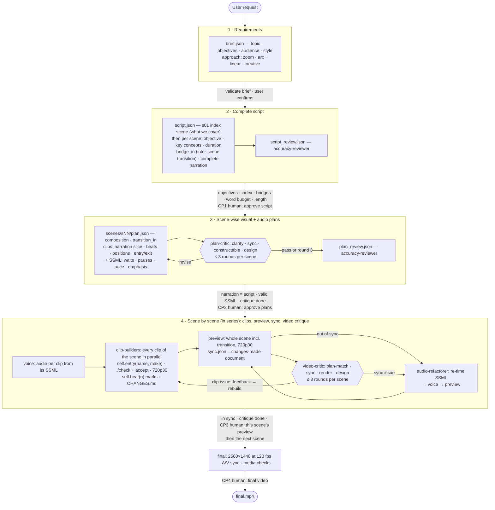

# Text-2-Shorts

Turns a topic into a narrated **Manim** explainer video: 2560×1440 (16:9) at 120 fps (60–120), with the font you choose.
Claude Code is the execution environment: each video is produced by one Claude Code session that runs inside its own
isolated run folder, guided by a skill, two subagents and hooks. Python only holds deterministic steps (validation,
voice, checks, rendering, state) that the session calls. There are no per-stage API calls or prompts in app code.

## Setup
```bash
sudo apt install ffmpeg texlive-latex-base texlive-latex-extra dvisvgm libpango1.0-dev pkg-config bubblewrap socat
uv sync                       # Python deps (manim==0.20.1 pinned) + the `text-2-shorts` command
claude --version              # Claude Code ≥ 2.1.275, logged in
cp .env.example .env          # optional settings
uv run pytest -q              # deterministic suite, no LLM calls
```
Voice credentials (AWS Polly or Google Cloud TTS) and details: `docs/deployment-guide.md`.

## Use it
```bash
uv run text-2-shorts new "<topic>" --objective "…" --approach zoom --minutes 2 --audience "…" --tts polly --voice Matthew
uv run text-2-shorts open runs/<id>     # interactive Claude Code session for this run, inside its jail
```
From a repo session, `/make-short <topic>` asks the setup questions and runs `text-2-shorts new` for you. The run session then
works through the stages below and asks you at four checkpoints (CP1 script · CP2 scene visual plans · CP3 each
scene's preview · CP4 final video). Re-running `text-2-shorts open` resumes from where the run stopped.
`uv run text-2-shorts status runs/<id>` shows approvals, every clip's state and the next steps from anywhere.

## Workflow
Each stage starts from the approved output of the one before, and the commands enforce it: plans are rejected
before CP1; `voice`, `task` and `preview` refuse to run before CP2; editing an approved artifact makes its
checkpoint stale. `text-2-shorts next <run>` hands the session the exact next batch of work; scenes are produced
one after another, and the clips of the current scene are built in parallel (each clip re-creates the objects it
takes over, `self.entry`, so it can be built and checked on its own). Everything is drafted at 720p30; only the
delivery is rendered at 1440p, 120 fps.

| Stage | Output | Gate → checkpoint | Guidance (by path) |
|---|---|---|---|
| 1 Requirements | `brief.json`: objectives, audience, style, approach (zoom · arc · linear fixed, or creative), length, constraints | schema; user confirms | `requirements.md` |
| 2 Complete script | `script.json`: index scene s01 (what the video covers), then per scene objective, key concepts, duration, spoken bridge, full narration; `script_review.json` | objectives covered, index previews every scene, bridges, word budget, length ±20%, no accuracy ERROR → **CP1** | `script-writing.md`, `narrative-structures.md`, `script-review.md`, `transitions.md` |
| 3 Visual + audio plans | per scene `plan.json`: composition, opening transition, clips (narration slice, beats, positions, entry/exit) with **SSML** (waits, pauses, pace); critique rounds; `plan_review.json` | narration = script word for word, valid SSML, **plan-critic ≤ 3 rounds**, no accuracy ERROR → **CP2** | `scene-visual-planning.md`, `audio-ssml.md` |
| 4 Clips + video | scene by scene: audio from SSML → all clips of the scene in parallel (720p30, beat marks, CHANGES.md) → scene preview + `sync.json` → **audio-refactorer** re-times the SSML → **video-critic ≤ 3 rounds** | `./check` + jailed `accept`, speech in sync with animation → **CP3** per scene | `scene-production.md` |
| Final | `final.mp4`, 2560×1440 at 120 fps | media checks → **CP4** | — |

Transitions have two levels: between clips of a scene, continuity with simple moves (the entry state is the
previous exit); between scenes, a spoken bridge (what was covered, what comes next, why it matters) and a visual
recap of the previous scene's final image.



## Architecture
```
run-environment/                  the execution environment, defined once (declarative, version-controlled)
  .claude-plugin/plugin.json      a Claude Code plugin, loaded with --plugin-dir
  skills/text-2-shorts-produce/   the staged workflow (CP1–CP4) + one reference per stage, read only at that stage:
    references/                   requirements · script-writing · narrative-structures · script-review ·
                                  scene-visual-planning · audio-ssml · scene-production · transitions · standards
  skills/manim-ce-0-20-1-reference/  version-pinned Manim topic cards + scripts
  agents/clip-builder.md          subagent: builds ONE clip in its prepared folder (fresh context per clip)
  agents/accuracy-reviewer.md     subagent: independent accuracy check → script_review.json, plan_review.json
  agents/plan-critic.md           subagent: one critique round of a scene plan (≤ 3 per scene)
  agents/video-critic.md          subagent: one critique round of a scene preview (≤ 3 per scene)
  agents/audio-refactorer.md      subagent: re-times a scene's SSML to its built video
  hooks/hooks.json                SessionStart → status + next batch; PostToolUse → log + validate what was written
  settings.json                   session sandbox (bubblewrap, fails closed) + permissions (secrets unreadable)
  workspace/CLAUDE.md             the per-run instructions copied into every run
runs/<id>/                        one run = one workspace (git-ignored)
```
- **Provisioning** (`text-2-shorts new`): preflight (LaTeX, ffmpeg, bwrap, Claude Code version), voice-credential check, then
  `runs/<id>/` with `brief.json`, `CLAUDE.md`, `environment_report.json`.
- **Isolation** (`text-2-shorts open`): Claude Code runs in a bubblewrap jail. The system and the repo are read-only; the run
  folder is writable, as are Claude Code's own state (`~/.claude`) and caches. `$HOME` is a private, throwaway tmpfs
  with tool folders and voice credentials mounted back read-only. One run cannot change another run or the shared
  code. Inside, Claude Code's own sandbox (`run-environment/settings.json`) confines every Bash command again (no network except
  `text-2-shorts voice`, secrets unreadable). LLM-written clip code is re-checked by `text-2-shorts accept` and rendered by `text-2-shorts final`
  in a further network-less jail.
- **Context**: `CLAUDE.md` is short; the skill says which reference to read at each step; the clip-builder gets a
  `TASK.md` with only its clip, the paths of the standards and three always-on Manim cards, and the cards specific
  to that clip. The session-start hook prints the run's state, so resuming costs one short block instead of
  re-reading files.
- **Validation loop**: right after the session writes `brief.json`, `script.json`, a `plan.json` or a review file,
  the PostToolUse hook validates it (schema, stage order, objectives, word budget, narration = script, empty scene
  boundaries, one colour per symbol); errors go straight back to Claude. Clips pass `./check` (validator → layout/timing probe → section render → frames) and `text-2-shorts accept`.

| `text-2-shorts` command | What it does (deterministic) |
|---|---|
| `validate <run> brief\|script\|script-review\|plan\|plan-review\|plan-critique\|video-critique` | schema + rules for what the session wrote |
| `next <run> [--json]` | the exact next batch: who does what (you, a subagent, a command, the user), for which target, reading which files; parallel batches for a scene's clips |
| `preview <run> sNN` | the whole scene at 720p30 with audio, `sync.json` (spoken vs shown time per beat, audio fit, builders' CHANGES.md), contact sheets |
| `hash <run> sNN plan\|video` · `doc <Names>` | the version id a critique round records · Manim 0.20.1 API cards for planners and critics |
| `voice <run>` | narration per clip via AWS Polly or Google Cloud TTS: symbols, units, abbreviations and M-vs-m spoken correctly (`app/narration.py`), SSML pauses, word timings → beat start times; only changed clips are re-synthesised |
| `task <run> sNNcMM` | prepares the clip-builder folder: `TASK.md`/`.json`, `API_CARDS.md`, `./check`, earlier clips |
| `accept <run> sNNcMM` | re-runs every gate in a jail; installs the clip only if all pass |
| `final <run>` | 2560×1440 section render per scene at 120 fps, per-clip audio sync (0.3 s lead-in), EBU R128 loudness, media checks |
| `approve` / `feedback` / `status` / `report` | checkpoints, scoped feedback, state + next steps, token totals from the run's transcripts |

Settings: `TEXT_2_SHORTS_FPS` (final frame rate, 60–120, default 120), `TEXT_2_SHORTS_PARALLEL` (scenes rendered at once, default 4), `TEXT_2_SHORTS_TTS`
(`polly` default, or `google`), `POLLY_ENGINE`, `POLLY_VOICE`, `GOOGLE_VOICE`.

## Logs and observability
- `runs/<id>/log.jsonl`: one row per tool call the session makes (`ts`, `tool`, `detail`), written by the hook.
- `runs/<id>/state.json`: approvals, each clip's status, open findings and key, and the session transcripts.
- `uv run text-2-shorts report runs/<id>`: tokens used by the run's sessions and subagents (net input, cache read/write,
  output), counted once per model response.

## Repository
```
app/cli.py                text-2-shorts CLI: new (provision), open (jail)
app/run_steps.py          validate · voice · task · accept · final · approve · feedback · status · report · hook
app/clip_gates.py         ./check gates used by the clip-builder and re-run by accept
app/narration.py          narration → speakable text / SSML; word timings → beat times; Polly / Google TTS
run-environment/          the Claude Code run environment (see Architecture)
schemas/models.py         Pydantic contracts (Brief, Script, ScenePlan, ClipPlan, ReviewReport, …) + json/ exports
tools/                    validator, layout probe, scene harness, assembly, doc cards, API index, preflight, cost report
.claude/skills/           repo-session skills: make-short (launcher) · text-2-shorts-clip-debugging · text-2-shorts-prompt-maintenance
docs/                     design reference: architecture-plan.md (§29 standards/sync/speech, §30 Claude Code-native
                          architecture), module-specifications.md, deployment-guide.md, naming-conventions.md,
                          proposed-stages/ (specs for stages not built yet)
tests/                    deterministic suite: validators, task → accept → final, jail isolation, hooks, speech
```
