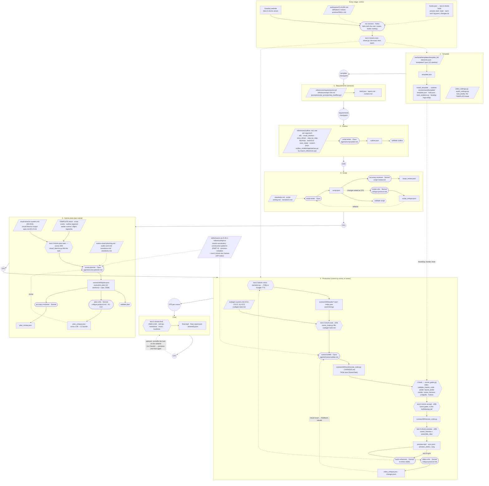

# Faraday — Curiosity, Illustrated

*(Text-2-Shorts: the `text-2-shorts` command keeps its name.)*

Turns a topic into a narrated **Manim** explainer video: 2560×1440 (16:9) at 120 fps (60–120), with the font you choose.
Claude Code is the execution environment: each video is produced by one Claude Code session that runs inside its own
isolated run folder, guided by a skill, two subagents and hooks. Python only holds deterministic steps (validation,
voice, checks, rendering, state) that the session calls. There are no per-stage API calls or prompts in app code.

## Setup
```bash
sudo apt install ffmpeg texlive-latex-base texlive-latex-extra dvisvgm libpango1.0-dev pkg-config bubblewrap socat
uv sync                       # Python deps (manim==0.20.1 pinned) + the `text-2-shorts` command
claude --version              # Claude Code ≥ 2.1.275, logged in
cp .env.example .env          # optional settings
uv run pytest -q              # deterministic suite, no LLM calls
```
Voice credentials (AWS Polly or Google Cloud TTS) and details: `docs/guides/deployment-guide.md`.

## Use it
```bash
uv run text-2-shorts new "<topic>" --objective "…" --approach visual_intuition --minutes 4 --audience "…" --tts polly --voice Matthew
uv run text-2-shorts open artifacts/runs/<id>     # interactive Claude Code session for this run, inside its jail
```
The run session works through the stages below and asks you at every checkpoint (template · requirements · CP0 outline · CP1 script ·
CP2 scene visual plans · CP3 each scene's preview · CP4 final video), then offers an optional reshuffle of the look. Re-running `text-2-shorts open` resumes from where the run stopped.
`uv run text-2-shorts status artifacts/runs/<id>` shows approvals, every stage, scene and clip status and the next steps from anywhere.
**Faraday is used from its website only.** Build it once (`cd frontend && npm ci && npm run build`), then
`uv run text-2-shorts serve` opens it at http://127.0.0.1:8765 (FastAPI; `npm run dev` in `frontend/` gives live reload on :5173):
start a run there, talk to the run's Claude Code session in its console (each message is one turn of the same session,
in the same jail), approve checkpoints and ask for changes. The website and the command line share the same code. Sign in with "Continue with Claude":
it uses the Claude account your Claude Code is signed in to (`claude auth login` if it is not). Then: every run, where it stands, what happens next,
scene previews and the final video; approve checkpoints, ask for changes and mark them applied or declined there too
(the same gates and decision records as `approve`, `feedback` and `resolve`).

## Workflow
Each stage starts from the approved output of the one before, and the commands enforce it: plans are rejected
before CP1; `voice`, `task` and `preview` refuse to run before CP2; editing an approved artifact makes its
checkpoint stale. `text-2-shorts next <run>` hands the session the exact next batch of work; scenes are produced
one after another, and the clips of a scene one at a time, in order: the next starts only after the current one
passed `accept`. Everything is drafted at 720p30; only the delivery is rendered at 1440p, 120 fps. Every stage,
scene and clip has a status (pending · in_progress · completed · failed · requires_refactoring ·
requires_user_approval · approved), kept in `state.json` and shown by `status`.

| Stage | Output | Gate → checkpoint | Guidance (by path) |
|---|---|---|---|
| 1 Template | `template.json`: look and sound chosen on the website's Template stage, first (a starter from the gallery: six dark and six light, each its own design, then optionally Build Your Own below it: any element changed, five to a custom value; previews: every option, full screen at 2560×1440, a rendered still, a voice sample) | **template** checkpoint | `requirements.md` |
| 1 Requirements | `brief.json` (objectives, audience, style, approach: seven presets (ELI5, Visual Intuition, Story-Driven, Step-by-Step, Feynman, Technical, Case Study) or custom; length, detail, depth, complexity, visual and audio expectations, constraints); `topics.md` (request modifier); `content.md`; optional `preferences.json` | schemas → **requirements** checkpoint | `requirements.md`, `topic-list.md` |
| 2 Outline | `outline.json`: segments with type, timing, talking points, visual plan — validated by `VideoOutline` and the approach's stages (`backend/schemas/outline_models/approaches.py`) | every stage in order, segment count, 10–120 s, transitions, visual-plan rules → **CP0** | `outline-<approach>.md`, one per approach (generated from the approach table by `runtime-environment/prompts/export_references.py`) |
| 3 Complete script | `script.json`: index scene s01 (what the video covers), then one scene per outline segment: objective, key concepts, duration, spoken bridge, full narration, on-screen text, animations, audio and transition needs, dependencies; `script_review.json` | objectives covered, every segment narrated in order, bridges, word budget, length ±20%, no accuracy ERROR → **CP1**; changes asked at CP1 → one **script-critic** round, one refactor, back to the user | `script-writing.md`, `script-review.md`, `transitions.md` |
| 4 Visual + audio plans | per scene the Visual Director's `plan.json`: its `execution_plan` (atomic, time-ordered events: what, how, where, look, speech, why) and the fields derived from it: composition, opening transition, clips (narration slice, beats, positions, entry/exit) with **SSML** (waits, pauses, pace) and sound effects (the user's files); scored critique rounds; `plan_review.json` | narration = script word for word, on-screen text shown, valid SSML, **plan-critic score ≥ 85, ≤ 3 rounds**, no accuracy ERROR → **CP2** | `scene-visual-planning.md`, `audio-ssml.md` |
| 5 Scene code + video | scene by scene: audio from SSML → the **scene-builder** writes the scene's one `scene_code.py` (a `_clip_N` method per clip, 720p30 drafts, CHANGES.md) → scene preview + `sync.json` → **audio-refactorer** re-times the SSML → **video-critic score ≥ 85, ≤ 3 rounds**, each refactor recorded in `changes.json` → `changes.txt` | `./check` + jailed `accept`, speech in sync with animation; below the threshold after 3 rounds: requires attention → **CP3** per scene | `scene-production.md` |
| Final | `final.mp4`, 2560×1440 at 120 fps: stream parameters checked, scenes joined with the template's transition, music and sound effects mixed | media and delivery checks (resolution, 16:9, frame rate, audio, loudness, true peak, silence, black frames, decoding, duration, completeness) → **CP4** | — |

Transitions have two levels: between clips of a scene, continuity with simple moves (the entry state is the
previous exit); between scenes, a spoken bridge (what was covered, what comes next, why it matters) and a visual
recap of the previous scene's final image.



## Architecture
```
runtime-environment/                  the execution environment, defined once (declarative, version-controlled)
  .claude-plugin/plugin.json      a Claude Code plugin, loaded with --plugin-dir
  skills/text-2-shorts-produce/   the staged workflow (requirements, template, CP0–CP4) + one reference per stage, read only at that stage:
    references/                   requirements · script-writing · outline-<approach> (8) · script-review ·
                                  scene-visual-planning · audio-ssml · scene-production · transitions · standards
  skills/manim-ce-0-20-1-reference/  version-pinned Manim reference (vocabulary, patterns, mistakes) + scripts
  agents/script-writer.md         subagent (Opus): writes and refactors the outline and the script
  agents/scene-planner.md         subagent (Opus): the Visual Director; writes and refactors ONE scene's execution plan + plan.json
  agents/scene-builder.md         subagent (Opus): writes ONE scene's scene_code.py from its execution plan
  agents/accuracy-reviewer.md     subagent: independent accuracy check → script_review.json, plan_review.json
  agents/script-critic.md         subagent: one critique round of the script per change the user asks for at CP1
  agents/plan-critic.md           subagent: one scored critique round of a scene plan (≤ 3 per scene)
  agents/video-critic.md          subagent: one scored critique round of a scene preview (≤ 3 per scene)
  template_kit/                   look-and-sound kit: elements.json, 12 starter templates (6 dark, 6 light), gallery of every option
  video_settings.py · audio_settings.py   the template's look and sound — the one source clips and narration use
  look_renderer.py                our Manim drawing of a look: previews and the backdrop behind every clip
  generate_preview.py             previews: starters (previews/starters/), options in the user's look, the whole look, a voice sample
  agents/audio-refactorer.md      subagent: re-times a scene's SSML to its built video
  hooks/hooks.json                SessionStart → status + next batch; PostToolUse → log + validate what was written
  settings.json                   session sandbox (bubblewrap, fails closed) + permissions (secrets unreadable)
  workspace/CLAUDE.md             the per-run instructions copied into every run
artifacts/runs/<id>/                        one run = one workspace (git-ignored)
```
- **Provisioning** (`text-2-shorts new`): preflight (LaTeX, ffmpeg, bwrap, Claude Code version), voice-credential check, then
  `artifacts/runs/<id>/` with `brief.json`, `CLAUDE.md`, `environment_report.json`.
- **Isolation** (`text-2-shorts open`): Claude Code runs in a bubblewrap jail. The system and the repo are read-only; the run
  folder is writable, as are Claude Code's own state (`~/.claude`) and caches. `$HOME` is a private, throwaway tmpfs
  with tool folders and voice credentials mounted back read-only. One run cannot change another run or the shared
  code. Inside, Claude Code's own sandbox (`runtime-environment/settings.json`) confines every Bash command again (no network except
  `text-2-shorts voice`, secrets unreadable). LLM-written clip code is re-checked by `text-2-shorts accept` and rendered by `text-2-shorts final`
  in a further network-less jail.
- **Context**: `CLAUDE.md` is short; the skill says which reference to read at each step; the scene-builder gets a
  task with only its scene: the execution plan, the TEMPLATE, each clip's length from the voice, and the paths of
  the code generator's rules and the three Manim references. The session-start hook prints the run's state, so resuming costs one short block instead of
  re-reading files.
- **Models**: the run session, which is the user's conversation (the website console), refining requirements and
  routing, runs on Haiku (`claude-haiku-5-5`) and builds nothing itself. Every builder and refactor except audio
  runs on Opus (`claude-opus-5-5`): script-writer (outline, script), scene-planner (plans), scene-builder (code).
  Every critic and reviewer (script-, plan-, video-critic, accuracy-reviewer) and audio (audio-refactorer) run on
  Sonnet (`claude-sonnet-5-5`). All at medium effort. Settings: `SESSION_MODEL`, `BUILD_MODEL`,
  `REVIEW_AND_AUDIO_MODEL`, `EFFORT` in `backend/app/config.py` (the session is launched by `session_command` in
  `backend/app/sandbox.py`); subagents set `model`/`effort` in their frontmatter, and a test keeps them equal.
- **Everything visible**: the session runs with `--verbose` (every tool call's input and output shown as it
  happens); the hooks show the user each write (with its validation result), command and subagent, and the run
  state at session start; every event is also in `log.jsonl`; the commands print what they changed.
- **Prompt caching** (Claude Code, not this repo, controls it): a reference read once stays in the session's
  cached context. The cache lives 5 minutes by default (1 hour for the main conversation on a Claude subscription);
  `CLAUDE_CODE_PROMPT_CACHE_TTL=1h` and `CLAUDE_CODE_SUBAGENT_PROMPT_CACHE_TTL=1h` (Claude Code ≥ 2.1.242) request
  1 hour for the session and its subagents, `DISABLE_PROMPT_CACHING=1` turns caching off. Each subagent starts a
  fresh context, so the references it reads are cached only within its own run.
- **Validation loop**: right after the session writes `brief.json`, `script.json`, a `plan.json` or a review file,
  the PostToolUse hook validates it (schema, stage order, objectives, word budget, narration = script, empty scene
  boundaries, one colour per symbol); errors go straight back to Claude. Clips pass `./check` (validator → layout/timing probe → section render → frames) and `text-2-shorts accept`.

| `text-2-shorts` command | What it does (deterministic) |
|---|---|
| `validate <run> brief\|topics\|content\|outline\|preferences\|script\|script-critique\|script-review\|plan\|plan-review\|plan-critique\|video-critique\|changes` | schema + rules for what the session wrote |
| `templates` · `template <run> <name> [--set element=variant \| custom.element=value \| key=value]` | the starter templates · writes `template.json` (the website's Template stage does the same) |
| `next <run> [--json]` | the exact next batch: who does what (you, a subagent, a command, the user), for which target, reading which files; scenes in series |
| `preview <run> sNN` | the whole scene at 720p30 with audio, `sync.json` (spoken vs shown time per beat, audio fit, builders' CHANGES.md), contact sheets |
| `hash <run> script\|sNN [plan\|video]` · `doc <Names>` | the version id a critique round records · Manim 0.20.1 API cards for planners and critics |
| `voice <run>` | narration per clip via AWS Polly or Google Cloud TTS: symbols, units, abbreviations and M-vs-m spoken correctly (`backend/app/narration.py`), SSML pauses, word timings → beat start times; only changed clips are re-synthesised |
| `task <run> sNN` | prepares `scenes/sNN/work/` (`TASK.json`, `./check`, the accepted file to start from) and prints the scene-builder's task |
| `accept <run> sNN` | re-runs every gate in a jail; installs `scene_code.py` only if all pass |
| `final <run>` | 2560×1440 section render per scene at 120 fps, per-clip audio sync (0.3 s lead-in), stream-parameter check, template transition between scenes, the user's music and sound effects, EBU R128 loudness, media and delivery checks |
| `approve <run> <checkpoint> [--notes]` | records the user's decision (approved, approved with notes, forced) in `decisions.jsonl`; open change requests block it |
| `feedback <run> <target> --kind K --text T [--checkpoint C]` · `resolve <run> rNNN applied\|declined` | a validated change request in `requests.jsonl`, routed by `next`; a clip's visual request resolves when its scene is accepted |
| `status` / `report` | every stage, scene and clip status (saved in `state.json`), open requests + next steps; token totals from the run's transcripts |

Settings: `TEXT_2_SHORTS_FPS` (final frame rate, 60–120, default 120), `TEXT_2_SHORTS_PARALLEL` (scenes rendered at once, default 4), `TEXT_2_SHORTS_TTS`
(`polly` default, or `google`), `POLLY_ENGINE`, `POLLY_VOICE`, `GOOGLE_VOICE`.

## Logs and observability
One format for all three parts (`runtime-environment/faraday_logging.py`): `time level component logger  message`,
files rotated at 5 MB (three kept). `TEXT_2_SHORTS_LOG_LEVEL` (default `INFO`) and `TEXT_2_SHORTS_LOG_DIR` (default
`artifacts/logs/`) change them.
- **Backend** → `artifacts/logs/backend.log` (and the terminal): every request with its status and time, every refused
  request with its problems, runs created, templates saved, approvals, reshuffles, console turns and Claude Code exits.
- **Frontend** → `artifacts/logs/frontend.log`: the browser batches info and above to `POST /api/logs` (uncaught errors,
  crashes while drawing, failed requests, every action and page opened); everything also goes to the browser console.
- **Runtime environment** → `artifacts/runs/<id>/logs/runtime.log`: each `text-2-shorts` command the run session calls,
  why it stopped, every hook event (writes, validations, subagents); `artifacts/logs/runtime.log` for preview renders.
  Never on stderr, which would reach Claude's context.
- `artifacts/runs/<id>/log.jsonl`: one row per tool call the session makes (`ts`, `tool`, `detail`), written by the hook.
- `artifacts/runs/<id>/state.json`: approvals, each clip's status, open findings and key, and the session transcripts.
- `uv run text-2-shorts report artifacts/runs/<id>`: tokens used by the run's sessions and subagents (net input, cache read/write,
  output), counted once per model response.

## Repository
Full map, every module's responsibility and where each kind of change belongs: [`docs/PROJECT_STRUCTURE.md`](docs/PROJECT_STRUCTURE.md).
```
frontend/              the website in React (src/ → dist/), black and white: runs, Template (look and sound), console, approvals, final video, Reshuffle
backend/app/           the `text-2-shorts` command: cli.py (entry), config.py (every setting), commands/ (handlers),
                       workflow/ (the staged workflow's logic), sandbox.py, narration.py, utilities.py
backend/schemas/       Pydantic contracts for every file and payload (one module per domain) + json/ exports
backend/tools/         standalone scripts (also run in the render jail): ./check gates, validator, probe, harness,
                       assembly, doc cards, API index, preflight
runtime-environment/   the Claude Code run environment: agents, skills + references, templates, hooks, settings
artifacts/             runs/ (one folder per video), reports/, trash/ (awaiting deletion)
docs/                  PROJECT_STRUCTURE.md · guides/ · changes/ (dated change lists) · diagrams/ · history/
tests/                 deterministic suite: validators, task → accept → final, jail isolation, hooks, speech, web
```
