# Architecture plan — Text-to-Shorts: Claude-Code-backed, Manim-based explainer video generator

> **Implementation status (v0.2.0).** Built, smallest form that meets each spec:
> M2 runner → `pipeline.claude()` (LLM result cache, rate/usage-limit waits, start/end log rows) ·
> M3 ledger → `state.json` + `requests.jsonl` + `decisions.jsonl` + versioned `plan.json` (`app/run_steps.py`) ·
> M4 invalidation → content-hash keys (a clip's key includes the previous clip's code, so changes cascade in order) ·
> M5 steps + checkpoints → `text-2-shorts clips | voice | build | final | approve | feedback | status` ·
> M6 prompts → constants in `app/run_steps.py` · M7 → `tools/doc_cards.py` + API index in `.cache/` ·
> M8 → `app/clip_gates.py` (`./check`) + jailed re-check · M9 → `text-2-shorts voice` · M10 → `tools/assemble_clips.py` + `media_checks` ·
> M11 → `.cache/llm/` · M12 → `log_row` + `tools/cost_report.py` · M13 → `text-2-shorts` · M14 → preflight in `text-2-shorts new`.
> v0.3–0.4 added M15 speech (Polly/Google, SSML, word timings) and M16 video standards — see §29.
> **v0.5 inverted control** (§30): no runner/orchestrator any more — M2's `claude()`, M5's LLM steps and
> M6's prompt constants are gone; one Claude Code session per run does the reasoning, run-environment/ holds its skill,
> subagents and hooks, and `app/` keeps only deterministic commands (validate, voice, task, accept, final, …).
> **v0.6 naming** (`docs/naming-conventions.md`): `app/pipeline.py` → `app/cli.py`, `app/clips.py` → `app/run_steps.py`, `app/check.py` → `app/clip_gates.py`, `app/speech.py` → `app/narration.py` (now also the
> Polly/Google synthesizers), `app/graph/models/` → `app/outline_models/`, `env/` → `run-environment/`, `Plan.md` → `docs/architecture-plan.md`. Historical tables below keep the names of their time.
> **v0.7 workflow** (README → Workflow): requirements → complete script (`script.json`, CP1) → scene-wise visual
> plans (CP2) → clip-wise code, enforced in order; the outline stage and its prompts are replaced by the script stage.
> **v0.10**: the outline stage is back (CP0) with the `script_prompts` package and `app/outline_models/`;
> change requests, checkpoint decisions and standing preferences are validated contracts.
> Not built: M1 config file (`STAGES` + env vars instead), `outline_review` (existing critic + length check),
> `clip_reviewer` (human CP3), Docker. Sections below are the original design.

**Document status:** v1.0 · 2026-11-19 · single reference for product, architecture and implementation.
**Basis:** audit of `app.zip` (snapshot 2026-11-16/19), `Instructions`, the earlier
`Agentic_Mathematical_Video_Generation_Implementation_Plan.md`, Manim CE **0.20.1** installed and exercised in the
audit environment, Claude Code CLI reference (code.claude.com/docs, fetched 2026-11-19).

### Status legend (used everywhere in this package)
| Tag | Meaning |
|---|---|
| **[EXISTS]** | In `app.zip` today and working as described (verified by reading code; runtime not executed — no `claude` CLI in the audit environment). |
| **[EXISTS-DEFECT]** | In `app.zip` today, with a verified defect. |
| **[BUILT-HERE]** | Implemented and tested **in this package** (`tools/`, `schemas/`, `tests/` — 38 tests pass on Manim 0.20.1); not yet integrated into `app/`. |
| **[PROPOSED]** | Designed here, not implemented anywhere. |
| **[PROVISIONAL]** | A number/target chosen without measured baseline; replace after Phase 0 measurement. |

---

## 1. Executive Summary

**What we are building.** A tool that turns a topic or text into a 2–8-minute (content-driven) animated explainer:
narrated, mathematically correct, rendered with Manim Community Edition, produced through a controlled sequence of
Claude calls with human approval at four checkpoints.

**Where it stands.** `app.zip` is a working, compact CLI pipeline (`app/pipeline.py`, 549 lines + ~5.5k lines of
prompts) that already does: requirement refinement → outline (3 narrative approaches) with critic/refactor →
narration → local/Polly TTS → per-scene Manim "visual director" DSL with critic/refactor → a sandboxed Claude Code
agent that writes, renders, debugs and visually checks each scene → final jailed render → ffmpeg assembly, with a
per-call cost log. There is no frontend, no API server, no tests, no dependency manifest; the Claude Code skill that
drives it (`/make-short`) is referenced but not included.

**The central gap.** The product requirement is that the **clip** is the unit of generation, validation, caching and
regeneration. Today clips exist only as text (CLIP blocks in the DSL; "one method per clip" in code). Every LLM stage,
every check, every retry and every piece of human feedback operates on a whole **scene**; nothing is versioned, and
upstream edits do not invalidate downstream files (stale `plan.md`/`scene.py` can be rendered after an outline change).

**Verified defects that drive the redesign** (evidence in `reference/audit-evidence/`):
1. The plan critic bans APIs that exist and render on 0.20.1 (`GrowFromCenter`, `ShowPassingFlash`) and whitelists 12
   animations, contradicting the Director's catalog → refactor loops that cannot converge.
2. The "verified against v0.20.1" Manim catalog sent to three stages recommends `get_line_graph` (absent; it is
   `plot_line_graph`), `InteractiveScene` (ManimGL-only), and names not exported by `from manim import *`.
3. ~23k tokens of hand-written Manim reference are sent with every Director/codegen call; ~5.8k tokens of static
   instructions sit *after* the dynamic input in the Director prompt, so they can never be prompt-cached.
4. Format contradictions inside single calls (refactor asked for JSON while the plan is tagged text; class-name rules).
5. Missing preflight: MathTex needs `dvisvgm`, never checked (first render in the audit environment failed on it);
   the sandbox settings do not fail closed (`failIfUnavailable` absent).
6. A failed final-quality render falls back to the draft but the scene is still reported `READY`.

**The proposal in one paragraph.** Keep the working parts (CLI, `claude -p` runner, outline approaches and schemas,
TTS engines, sandbox model, cost log). Insert a clip layer: a **Clip Planner** writes each scene's clips with exact
narration and *continuity contracts*; narration is synthesized **per clip first**, so real audio durations become the
clips' timing budgets; a **sandboxed Clip Builder agent** writes **one clip file** (it physically cannot edit other
clips), gated by **deterministic** checks — API validation against an index generated from the installed Manim,
geometry/overlap/timing probe, single-clip render via Manim *sections* with exact entry state — before any LLM review.
A **run ledger + dependency graph** turns any human feedback into the minimum rebuild set. Hand-maintained Manim
catalogs are replaced by version-pinned API cards (~0.5–1.5k tokens per clip) and executable-tested topic cards.
Seven LLM roles remain (two existing, five new/narrowed); everything else is deterministic Python.

**What this package already proves [BUILT-HERE]:** API index builder, static validator (removed APIs, invented names,
forbidden imports, clip contracts), layout/timing probe (overlap, off-frame, per-clip duration vs narration),
scene harness (clip isolation + per-clip section renders, incl. 9:16), clip-level A/V assembly, invalidation planner,
doc-card retriever, preflight, prompt-catalog auditor, cost report, Pydantic contracts + JSON Schemas, 11 topic cards
(10 with examples rendered in tests, 1 removed-API table).

---

## 2. Product Vision and Definition

### 2.1 Vision
Anyone who can describe a concept in text gets a 3Blue1Brown-style explainer they would be willing to publish —
with the guarantee that every formula on screen was checked, every claim traceable to the approved plan, and every
change they ask for costs only the clips it touches.

### 2.2 Users and inputs
| Input | Required | Default | Notes |
|---|---|---|---|
| Topic / raw text | yes | — | Free text, may be a paragraph or notes. |
| Narrative approach | no | `zoom` | `zoom` (Conceptual Zoom), `arc` (Problem→Solution), `linear` [EXISTS]. |
| Target length | no | 2 min | 4–8 min typical; final length follows content (±20%). |
| Audience | no | "curious beginners" | Drives depth, vocabulary, pace. |
| Pace | no | medium | → target words-per-minute. |
| Aspect | no | 16:9 | 9:16 for Shorts [PROPOSED; harness support BUILT-HERE]. |
| Voice / TTS engine | no | Kokoro `af_heart` | Polly neural/generative/standard [EXISTS]. |
| Notes | no | "" | Style or content constraints. |

### 2.3 Hierarchy: Video → Scenes → Clips → Animation elements

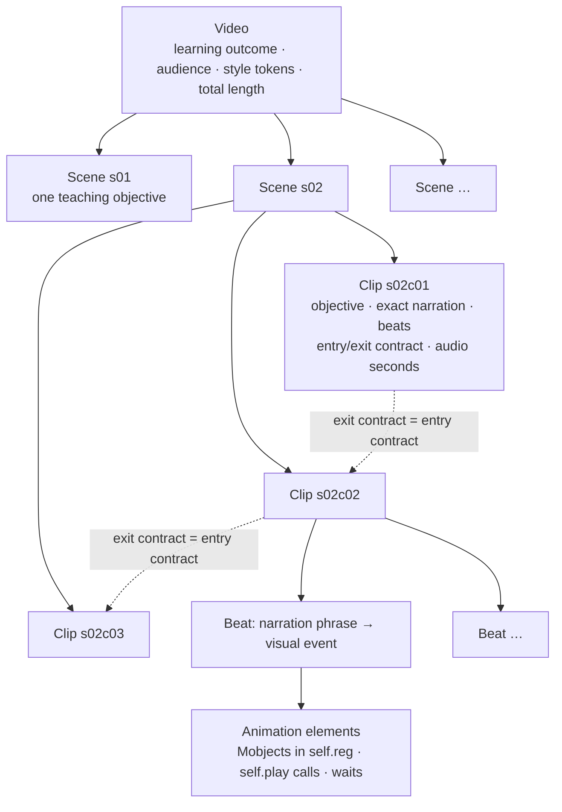
*Purpose:* the unit vocabulary used by code, prompts, ledger and UI. Contracts (dotted) are the only coupling between
clips; code and renders of one clip never feed another clip's generation.

**Video level.** Owns: learning outcome, audience, narrative approach, total duration (sum of clip audio + pads),
style tokens (background, colour roles, font roles), voice, scene order and transitions, final output spec
(MP4 H.264 + AAC 48 kHz, loudness −16 LUFS integrated, 16:9 1920×1080 or 9:16 1080×1920, 30 fps).
**Scene level.** Owns: one teaching objective, segment type (hook/concept/math/…), talking points, visual plan prose,
transition to next scene, colour roles, the ordered clips, and scene entry/exit (scenes start from an empty frame
unless the plan states continuation).
**Clip level (central unit).** Owns: one objective; exact narration (TTS input); on-screen math (exact LaTeX);
1–8 beats keyed to narration phrases; entry and exit continuity contracts (registry names + semantic zones + camera);
estimated and measured seconds; Manim topics; dependencies; its own code file, checks, renders, review, versions.
**Animation elements.** Mobjects held in `self.reg` (named per contract) or local to the clip; `self.play(..., run_time)`
and `self.wait` calls; emphasis beats.

**How clips form a scene.** The harness composes `scene.py` from `clips/clip_NN.py`; each clip opens a Manim section,
so a single render yields one MP4 per clip with exact continuity; clip MP4s are muxed with their own narration
(drift bounded per clip) and concatenated. **How scenes form the video.** Scene MP4s are concatenated in plan order,
loudness-normalised once, then final checks run (§16.6).

**Continuity.** Objects, expressions, diagrams and camera states that carry forward are declared in the exit contract
of clip N and the entry contract of clip N+1. Enforced three times: Pydantic validator at planning (entry ⊆ previous
exit), static validator on code (`CONTRACT_READ`/`CONTRACT_EXIT`), and at render the registry is whatever the previous
clip's code actually left (sections execute earlier clips). Scenes do not share registry state by default.

### 2.4 Scope
**v1 in scope:** 2D Manim CE animations; English narration; four checkpoints; clip-level regeneration; 16:9 and 9:16;
Kokoro + Polly TTS; local single-user execution via CLI + Claude Code skill.
**v1 out of scope (Future §28):** 3D scenes, background music/SFX mixing (hooks reserved), captions burn-in, web UI,
multi-user/server deployment, automated web research by default, non-English narration, parallel clip production.

---

## 3. Existing Application Audit

### 3.1 Inventory (`app.zip`, `__pycache__` excluded)
| Path | Lines | Role | Status |
|---|---:|---|---|
| `app/pipeline.py` | 549 | All stages, CLI, `claude -p` wrapper, TTS, render, assembly | [EXISTS] |
| `app/sandbox.json` | 9 | Claude Code Bash sandbox settings for the render agent | [EXISTS-DEFECT] §3.3-14 |
| `app/graph/models/base_models.py` | 99 | `OutlineSegment`, `BaseVideoMeta`, enums | [EXISTS] |
| `app/graph/models/{conceptual_zoom,problem_solution_arc,classic_linear_narrative}.py` | 66–69 | Outline schemas per approach | [EXISTS] |
| `app/graph/prompts/script_gen_prompt.py` | 1709 | `REQ_MODIFIER_SYSTEM` + 3 outline approach prompts | [EXISTS] |
| `app/graph/prompts/outline_critic_prompt.py` | 147 | Outline critic + refactor | [EXISTS-DEFECT] |
| `app/graph/prompts/visual_plan_gen_prompt.py` | 776 | Visual Director → XML-tagged Scene Execution Plan DSL | [EXISTS-DEFECT] |
| `app/graph/prompts/visual_plan_critic_prompt.py` | 145 | DSL critic + refactor | [EXISTS-DEFECT] |
| `app/graph/prompts/visual_code_gen_prompt.py` | 919 | Codegen identity, 7-step protocol, 13 rules | [EXISTS-DEFECT] |
| `app/graph/prompts/render_debug_prompt.py` | 474 | Render-error debug protocol | [EXISTS] (partly unused) |
| `app/graph/prompts/manim_reference.py` | 1038 | Vocabulary, construction patterns, common mistakes catalogs | [EXISTS-DEFECT] |
| `.claude/skills/make-short/SKILL.md` | — | Referenced in `pipeline.py` docstring | **missing from zip** (reconstructed: `skills/custom/make-short`) |
| tests, pyproject/requirements, README, frontend, API server | — | — | **absent** |
| `.pyc` files compiled by CPython **3.14** | — | Runtime evidence | Package tests here ran on 3.12; see risk R9 |

Dependencies inferred from imports: `pydantic` v2, `python-dotenv`, `kokoro_onnx` (lazy), `boto3` (lazy), Manim
(invoked via `python -m manim`), system `ffmpeg/ffprobe`, `bwrap`, `socat`, `claude` CLI. Environment variables read:
`T2S_QUALITY`, `T2S_MODEL`, `TTS_ENGINE`, `KOKORO_DIR`, `KOKORO_VOICE`, `POLLY_VOICE` (+ AWS chain).

### 3.2 Component-by-component
Each entry: purpose · internals · I/O · dependencies · interactions · status · limitations → improvement.

**C1 `claude()` LLM wrapper** [EXISTS]. One `claude -p` subprocess per call; system prompt always written to
`runs/<id>/.prompts/<stage>[_NNN].md` (argv limit); structured output via `--json-schema` from Pydantic; non-agent
calls use `--system-prompt-file` + `--tools ""` + `--safe-mode` + `--no-session-persistence`; agent calls use
`--append-system-prompt-file`, `--restricted`, `--tools Read,Write,Edit,Bash`, sandbox settings, `--permission-mode
acceptEdits`, `--permission-prompts none`. Retries once; appends a JSON line per attempt to
`log.jsonl` (stage, model, effort, ok, cost, duration, cache read/write tokens, error). Raises after two failures.
*All flags verified to exist in the current CLI reference* (`--restricted` needs ≥ 2.1.248, `--permission-prompts`
≥ 2.1.259). *Limitations:* no error classification (auth errors, rate limits, timeouts, schema failures all retried
identically and immediately, no backoff); no artifact cache — re-running a step always pays; prompt file overwritten
per call (no history); `T2S_MODEL` override is global. → becomes `app/llm/runner.py` (§9.4, §21).

**C2 `cmd_new` (refine)** [EXISTS]. Slugged run dir `runs/<YYYYmmdd-HHMMSS>-<slug>`; Haiku/low rewrites the
requirement with `REQ_MODIFIER_SYSTEM`; writes `brief.json`. Fine; becomes stage `refine`.

**C3 `cmd_outline`** [EXISTS-DEFECT]. Generates the outline with the approach's ~7k-token system prompt and schema;
up to 2 critic rounds (`OUTLINE_CRITIC_SYSTEM`, Sonnet/high) each followed by a full refactor (Sonnet/medium); then a
narration call for **all** scenes; prints a summary table. With `--feedback`: a fake critique wrapping the human text
is passed to the refactor prompt, and narration is regenerated for all scenes. *Defects:* arithmetic checks delegated
to the LLM; refactor prompt omits schema-required fields; feedback not persisted; any outline edit regenerates all
narration and (after `tts`) all audio; existing plans/scenes are **not** invalidated.

**C4 `cmd_tts`** [EXISTS]. Kokoro (ONNX, model downloaded on first use from GitHub releases, **no checksum**) or
Polly (3000-char chunking); per-scene `narration.mp3`, measures `audio_seconds`. Always re-synthesizes every scene.

**C5 `cmd_plan` (Visual Director + critic + refactor)** [EXISTS-DEFECT]. Per scene: Director prompt (system: role +
3 catalogs ≈ 16.8k tokens; user: inputs + static output spec ≈ 5.8k tokens) produces the XML-tagged Scene Execution
Plan with frame-level CLIP blocks; up to 2 critic rounds + refactors; `--feedback` path uses refactor with a fake
critique. Duration = `ceil(audio_seconds)`. Runs scenes through a thread pool with `MAX_PARALLEL = 1` (sequential) and a
20 s "cache warm-up" sleep that never triggers at parallelism 1. *Defects:* critic contradictions (§1 #1), JSON/tagged
format conflict, non-cacheable static spec, catalog errors (§1 #2), no clip-level granularity.

**C6 `cmd_render` (scene agent + final render)** [EXISTS-DEFECT]. Refuses to run without `bwrap`/`socat` (good: otherwise
Claude Code would run Bash unsandboxed). Per scene: one Claude Code agent session (Sonnet/high; retry Sonnet/xhigh)
with ≈25.7k appended tokens (codegen + debug + protocol) writes `scene.py`, renders draft `-ql`, ≤ 6 renders, checks
duration ≥ narration with ffprobe, extracts frames every 3 s and looks at them (≤ 2 visual passes), returns
`SceneResult`. Then a **bubblewrap-jailed** final render (read-only host, no network, writable scene dir + ~/.cache) at
`T2S_QUALITY` (`-qh`); copies `clip.mp4`, makes `thumb.png`. *Defects:* final-render failure silently falls back to the
draft yet keeps `READY`; agent's READY claim is trusted (no independent re-check); frame sampling every 3 s misses
short overlaps; the whole scene is regenerated for any feedback; draft and visual checks are LLM work that geometry
could do.

**C7 `cmd_assemble`** [EXISTS]. Per scene: pad shorter of video (freeze) / audio (silence), re-encode; concat with
`-c copy`; prints total Claude cost from `log.jsonl`. Skips unrendered scenes (reported). No loudness normalisation,
captions, or transitions. Drift bounded per scene (padding), not per clip.

**C8 Outline schemas** [EXISTS]. Clean Pydantic v2 models; `scene_id` aliased `id` with `populate_by_name`. Kept as is.

**C9 Prompt modules** — see §11.1 for prompt-level findings.

**C10 Observability** [EXISTS]. `log.jsonl` per run, prompts saved, cost printed at assembly. Good base; lacks prompt
version, input hashes, token counts (input/output), clip ids, cache-hit (artifact) info.

**C11 Human-in-the-loop** [EXISTS, minimal]. Human = the operator in the Claude Code session using `/make-short`;
feedback via `--feedback` at outline/plan/render, scene-granular, not stored, no approval states, no versions.

### 3.3 Verified findings (numbered; referenced throughout)
| # | Finding | Evidence |
|---|---|---|
| 1 | Plan critic bans `GrowFromCenter`, `ShowPassingFlash` — both exist and rendered in 0.20.1 | audit json; `/tmp` render test reproduced in `tests/test_api_index.py` |
| 2 | Plan critic "TRANSITION SANITY" whitelist (12 anims) contradicts Director catalog | `visual_plan_critic_prompt.py` dimension 5 |
| 3 | Catalog recommends `get_line_graph` (0.20.1: `plot_line_graph`) | `manim_reference.py` L513, L633; `test_api_index.py` |
| 4 | Catalog lists `InteractiveScene` (ManimGL), `GenericGraph`/`LayoutFunction` (not star-exported) | audit json |
| 5 | Refactor prompts demand JSON for a tagged-text plan; pipeline appends a contradicting note | `REFACTOR_SYSTEM`, `cmd_plan.keep_format` |
| 6 | Class naming rule conflict codegen vs agent protocol; codegen asks for summary/assumption sections the agent mode forbids | `visual_code_gen_prompt.py` §OUTPUT FORMAT vs `SCENE_AGENT_PROTOCOL` |
| 7 | ~5.8k tokens static output spec placed after dynamic input (uncacheable) | `_build_user_prompt` |
| 8 | Prompt payload sizes (catalogs 14.9k tok; Director sys 16.8k; agent appended 25.7k) | `reference/audit-evidence/prompt-sizes.md` |
| 9 | Outline edits regenerate all narration/TTS and do not invalidate plans/code | `cmd_outline`, `cmd_tts`, no dependency tracking |
| 10 | Final render failure → draft used, status stays READY | `cmd_render` |
| 11 | No `dvisvgm` check; MathTex fails without it | audit environment render failure |
| 12 | 9:16 impossible as is: `-ql/-qh` override manim.cfg pixel size | verified: 1080×1920 cfg + `-ql` → 854×480 (`test_portrait_render_is_actually_portrait`) |
| 13 | LLM retries unclassified, immediate | `claude()` |
| 14 | Sandbox lacks `failIfUnavailable`, reads of `~/.aws` (Polly creds) not denied | `sandbox.json`; Claude Code settings docs |
| 15 | Kokoro model downloaded without integrity check | `kokoro_tts` |
| 16 | Feedback not persisted; no versions; artifacts overwritten | all `cmd_*` |
| 17 | `/make-short` skill missing from zip | docstring vs archive listing |

### 3.4 What is preserved
CLI-first design; `claude -p` runner and its flag set; outline approach prompts and schemas; refine stage; Kokoro/
Polly engines; Claude Code sandbox + bwrap final jail; per-call JSON logging with cost and cache tokens; sequential
execution; human-driven operation through a Claude Code skill.

---

## 4. Current Architecture [EXISTS]

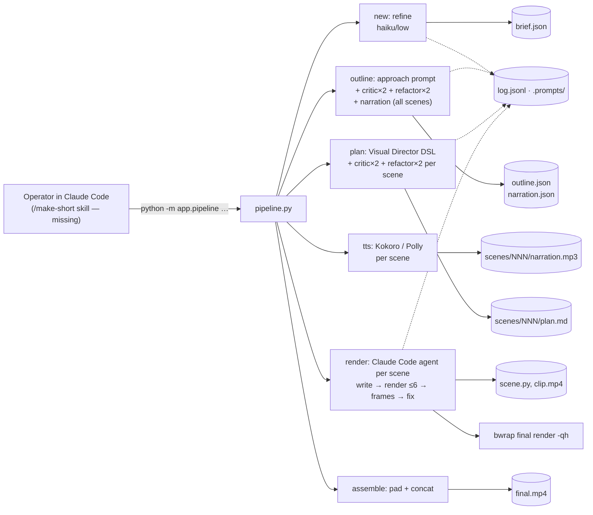
*Purpose:* today's data flow. Every arrow into a store overwrites the previous file; nothing records which inputs
produced which output.

---

## 5. Proposed Architecture

### 5.1 Layers
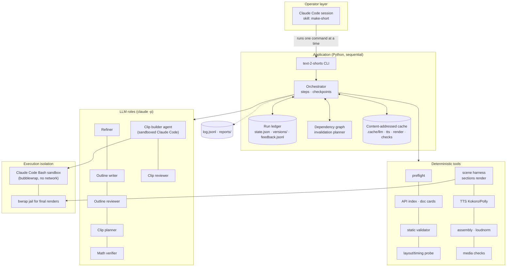
*Purpose:* separation of concerns. Claude Code appears twice by design: as the **operator console** (a human-facing
session that only runs CLI commands) and as the **clip-builder runtime** (headless `claude -p` sessions launched by the
orchestrator, sandboxed, one clip each). Durable state lives only in the ledger and cache — never in a chat.

### 5.2 Key design decisions (ADR summary)
| ID | Decision | Alternatives | Reason |
|---|---|---|---|
| D1 | Keep `claude -p` subprocess runner (wrapped in `app/llm/runner.py`) | Anthropic SDK directly; Agent SDK | Works today; supports subscription or API-key auth; gives the sandboxed agent loop for free. Runner interface lets a future SDK backend slot in (§28). |
| D2 | Plain Python state machine + JSON ledger; **no LangGraph** (deviates from the earlier plan) | LangGraph | Requirement is sequential execution with few stages; checkpoint = ledger file; avoids a dependency and a second state model. Revisit only if parallel/branching workflows arrive. |
| D3 | Clip = one file `clips/clip_NN.py` with one function; `scene.py` generated | One scene file with clip methods (today); one Scene class per clip | File-level isolation makes "do not touch other clips" a permission, not an instruction; one scene class keeps natural object continuity. |
| D4 | Render via Manim **sections**: per-clip MP4s from one scene render; single-clip draft = earlier sections `skip_animations` | Re-create entry state per clip (`setup_entry`) | Exact entry state with zero reconstruction code; verified on 0.20.1 (`test_scene_harness.py`). |
| D5 | **Audio first**: TTS per clip right after plan approval; durations drive code | Estimate durations, fix later | Removes the main sync failure mode (narration vs animation); TTS is cheap/local and cached by text hash. |
| D6 | Remove the scene-level Director DSL + its critic/refactor loop | Keep DSL per clip | The DSL is a 2nd, unexecutable spec of the same thing; ~40% of per-scene tokens; its critic contradicts its catalog. Clip plans (beats + contracts) stay human-reviewable; precision comes from code + deterministic gates. |
| D7 | Manim knowledge = generated API cards + tested topic cards, retrieved by exact names/closed topic list | Hand catalogs; embeddings/semantic search | Version-true by construction; deterministic, cacheable; ~0.5–1.5k tokens per clip vs ~15k. No vector DB to operate. |
| D8 | Geometry/timing/contract checks deterministic; one multimodal LLM reviewer for semantics only, conditional | Separate animation/layout/math critics on every clip | Measurable checks shouldn't cost tokens; one reviewer sees the evidence once (§9.3). |
| D9 | Math verified at plan stage, whole video, once | Per-clip math critic after render | Errors originate in planning; fixing text is cheaper than re-rendering. |
| D10 | Four human checkpoints, clip-scoped feedback mapped to graph nodes | Fully autonomous | Product requirement; also the cheapest quality gate for subjective issues. |

### 5.3 Proposed end-to-end pipeline
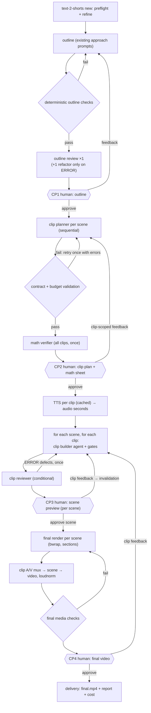
*Purpose:* the controlled, sequential order. Compared with the order suggested in `Instructions` §4: research becomes
optional and pre-outline; narration is written *during* clip planning (not as a separate script pass); audio timing
precedes visual design; documentation retrieval moves *inside* code generation (exact names known only then);
critics/refactor are conditional; final checks run before (not after) the human sees the final video.

---

## 6. Functional Requirements
| ID | Requirement | Phase | Status |
|---|---|---|---|
| FR-01 | Create a run from topic + options; preflight before any paid call | 2 | partial [EXISTS] / preflight [BUILT-HERE] |
| FR-02 | Refine requirement; generate outline in one of 3 approaches | — | [EXISTS] |
| FR-03 | Deterministic outline checks + one LLM review; refactor only for ERROR | 4 | [PROPOSED] |
| FR-04 | Plan each scene as 2–6 clips with narration, beats, math, contracts (validated) | 5 | contracts [BUILT-HERE], stage [PROPOSED] |
| FR-05 | Verify math/claims across all clips before approval | 5 | [PROPOSED] |
| FR-06 | TTS per clip, cached by (text, voice, engine); measure seconds | 12 | engines [EXISTS] |
| FR-07 | Build each clip in isolation (own file, sandbox), with deterministic gates before render and review | 6–8 | tools [BUILT-HERE] |
| FR-08 | Render single-clip drafts with exact entry state; final per-scene renders yield per-clip MP4s | 8 | [BUILT-HERE] harness |
| FR-09 | Conditional multimodal clip review | 9 | [PROPOSED] |
| FR-10 | Four checkpoints; approve/revise/reject at video, scene, clip level; feedback persisted | 10 | [PROPOSED] |
| FR-11 | Regenerate only artifacts invalidated by a change; explain why (`text-2-shorts explain`) | 11 | planner [BUILT-HERE] |
| FR-12 | Clip-level A/V assembly, loudness normalisation, final media checks | 12 | assembly [BUILT-HERE] |
| FR-13 | Resume any interrupted run from the ledger | 2 | [PROPOSED] |
| FR-14 | Per-run cost/time/quality report | 13 | report [BUILT-HERE] |
| FR-15 | 16:9 and 9:16 output | 8 | harness [BUILT-HERE] |
| FR-16 | Optional topic research with sources (off by default) | 14+ | [PROPOSED] |

## 7. Non-Functional Requirements
| ID | Requirement | Measure | Target |
|---|---|---|---|
| NFR-01 Correctness | No unsupported Manim API reaches render | validator REMOVED/UNKNOWN findings at render time | 0 (hard gate) |
| NFR-02 Honesty | No step reports success without tool evidence | orchestrator re-check of agent READY | 100% re-checked |
| NFR-03 Sync | Per-clip A/V difference after mux | `assemble` report | narration never cut; video pad ≤ 1.5 s [PROVISIONAL] |
| NFR-04 Cost | Cost per clip / per minute of video | `cost_report.py` | baseline (Phase 0) then −30% [PROVISIONAL] |
| NFR-05 Regeneration locality | Clips rebuilt after a single-clip visual feedback | ledger | exactly 1 clip (+ its scene/video assembly) |
| NFR-06 Resumability | Work lost on interruption | ledger | ≤ the in-flight step |
| NFR-07 Reproducibility | Same inputs + cache → same artifacts; full provenance | GenerationMetadata on every artifact | 100% |
| NFR-08 Isolation | Generated code: no network, writes only in its dir; secrets unreadable | sandbox + bwrap config tests | enforced, fail-closed |
| NFR-09 Sequential LLM use | Concurrent LLM calls | runner | 1 (config) |
| NFR-10 Maintainability | Prompt/API drift detected in CI | `audit_prompt_catalog.py`, topic-card tests | CI green |
| NFR-11 Latency | Wall time per clip build | log | baseline then tune [PROVISIONAL] |

---

## 8. Video → Scene → Clip Design (production lifecycle)

### 8.1 Clip lifecycle
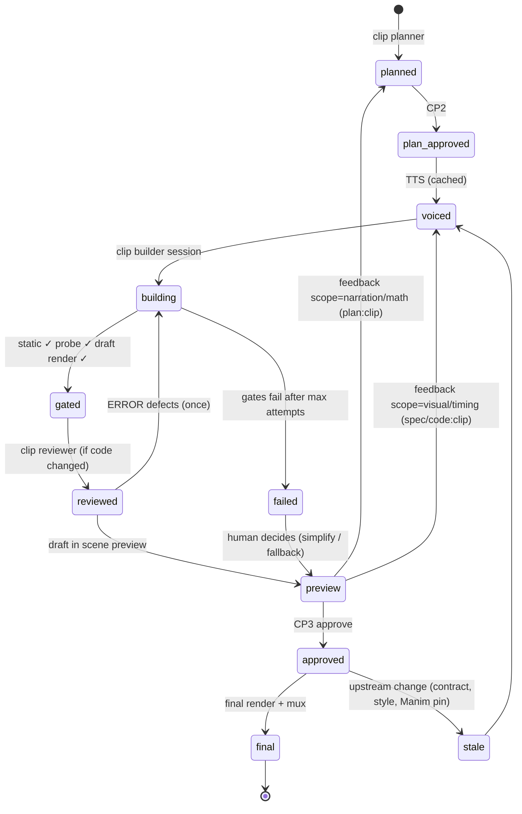
*Purpose:* every clip state is a ledger value (`ClipState.approval` + validation map); transitions are the only way an
artifact changes, so "what is the status of clip s02c03" always has one answer.

### 8.2 Script-to-animation transformation
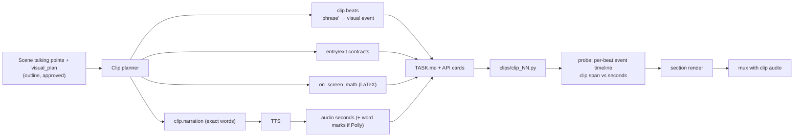
*Purpose:* where each property of the final animation is decided. Words are fixed before pixels; timing comes from
measured audio, not estimates; beats tie each visual event to a narration phrase so the reviewer can check sync.

### 8.3 Duration model
`clip_seconds = lead_in (0.25) + audio_seconds + tail (0.35)` [PROVISIONAL pads]; the probe requires
`audio_seconds − 0.5 ≤ animation_seconds ≤ audio_seconds + 1.5`. Scene seconds = Σ clip seconds; video = Σ scenes.
Word budget at planning: `words ≈ est_seconds × target_wpm / 60` (±10%), validated deterministically before TTS.
The 4–8-minute range is guidance to the outline stage (via `--minutes`); actual length follows content (±20% accepted
at CP1, explicit at CP2 where real word counts exist).

---

## 9. Complete Agent Architecture

### 9.1 The 20 responsibilities → 7 LLM roles + deterministic components
| # | Responsibility (Instructions §3) | Implemented by | Kind | Boundary reason |
|---|---|---|---|---|
| 1 | Input understanding | **Refiner** [EXISTS] | LLM haiku/low | Free text needs interpretation; cheap model suffices. |
| 2 | Topic research & context | **Researcher** (optional, off) | LLM + web | Costly; most math topics don't need it; adds sources risk. |
| 3 | Concept/math verification | **Math verifier** | LLM sonnet/high | Different task & rubric from writing; runs once on text. |
| 4 | Video structure planner | **Outline writer** [EXISTS] | LLM | Existing approach prompts are the product's narrative IP. |
| 5 | Scene breakdown | Outline writer [EXISTS] | LLM | Scenes are the outline's segments already. |
| 6 | Clip planning | **Clip planner** | LLM sonnet/high | Clip boundaries + narration + contracts must be decided together per scene. |
| 7 | Script generator | Clip planner | LLM | Narration written where timing is decided (merges today's narration call). |
| 8 | Narration & audio planner | Clip planner (words) + TTS module (audio) | LLM + det. | Audio is synthesis + measurement. |
| 9 | Visual design | Clip planner (beats/zones) + Clip builder (layout in code) + style tokens | LLM | Visual intent reviewable in plan; precise layout only meaningful in code. |
| 10 | Manim docs / API reference | `build_manim_api_index` + `doc_cards` + topic cards | det. | Lookup, not reasoning. |
| 11 | Manim code generator | **Clip builder agent** | LLM agent | Needs tool use (render, read errors, look at frames). |
| 12 | Code execution | `scene_harness` (+ sandbox) | det. | Running code is not an LLM job. |
| 13 | Code validation | `validate_manim_code` | det. | AST + index. |
| 14 | Animation quality critic | **Clip reviewer** | LLM multimodal | Semantic judgement on frames. |
| 15 | Mathematical accuracy critic | Math verifier (text) + Clip reviewer `MATH_VISUAL` | LLM | Text errors caught early; visual misrepresentation needs frames. |
| 16 | Visual layout critic | `layout_probe` (+ reviewer CLARITY/STYLE) | det. (+LLM) | Overlap/off-frame/size are geometry. |
| 17 | Refactoring agent | Clip builder in repair mode (same session type, LAST FINDINGS) | LLM agent | A separate refactorer would need the same context; targeted repair beats rewrite. |
| 18 | Clip consistency | Pydantic contract validator + validator CONTRACT_* + sections | det. | Contracts are data. |
| 19 | Scene integration | `scene_harness compose/render` | det. | Composition rule is fixed. |
| 20 | Final assembly | `assemble_clips` + media checks | det. | ffmpeg. |

**Outline reviewer** (role 7 of 7) keeps the existing critic's purpose with a fixed prompt.

### 9.2 Orchestration sequence
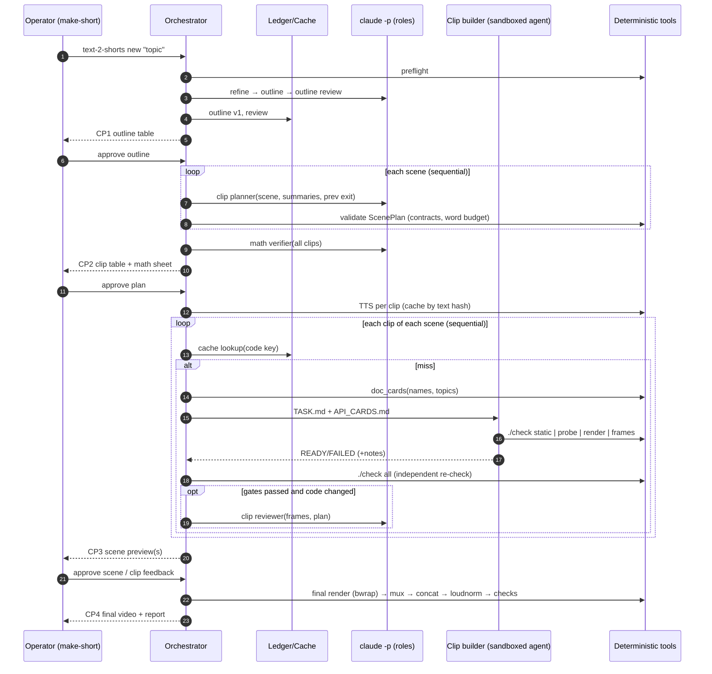
*Purpose:* who talks to whom, in which order. Only the orchestrator writes the ledger; LLM roles receive files/strings
and return validated objects; the agent's verdict is re-checked deterministically.

### 9.3 Can critics be combined without losing quality?
Yes, for three reasons specific to this system: (a) geometry, timing and API correctness — the bulk of today's
"visual layout" and "code" criticism — are exact deterministic checks, so the remaining LLM judgement is semantic;
(b) the three semantic questions (does the frame show what the narration says / is the math depicted correctly / is it
clear and on-style) use the same evidence (contact sheet + plan), so separate critics would pay for the same images
three times; (c) defects are typed (`code` field), so a single call still yields separable, routable findings.
What stays separate: the **math verifier on text** (different time — before rendering — and different input).
Guard against quality loss: Phase 9 compares single reviewer vs split critics on the golden set (§22.4) before
removing the split option from config.

---

## 10. Agent Responsibilities and Contracts

Common to every LLM role: called through `runner.run(stage, system, user, schema)`; model/effort/timeout/retries from
`config/stages.yaml`; output validated against the Pydantic model (one retry with the validation error appended);
`GenerationMetadata` recorded; cache lookup before the call with key = hash(prompt_id, model, effort, input hashes).
Tools: none (`--tools ""`) except the clip builder. Failures follow §21.

| Role | Purpose / scope | Inputs (only these) | Output | Model / effort | Runs when | Validation | Retry / failure | Token notes |
|---|---|---|---|---|---|---|---|---|
| Refiner [EXISTS] | Turn raw text into a precise brief | requirement | text | haiku / low | `text-2-shorts new` | non-empty | 2 attempts → fail run | ~0.5k sys |
| Outline writer [EXISTS] | Scenes with talking points, visual plan, durations | refined brief, minutes, pace, audience, notes | approach outline schema | sonnet / high | after refine; outline feedback | schema + det. checks | schema retry once; det. fail → 1 retry with errors | ~7k static sys (cache) |
| Outline reviewer | Find accuracy/order/density defects | outline JSON, audience, topic | `CriticResult(outline)` | sonnet / medium | once per outline version | defects need field path | invalid → retry once; then skip (human still reviews) | small |
| Clip planner | One scene → clips (narration, beats, math, contracts, topics) | video meta, style, scene, other-scene one-liners, prev scene exit, scoped feedback | `ScenePlan` | sonnet / high | per scene after CP1; on plan-scoped feedback | Pydantic (ids, contracts), word budget ±10%, ≤ 30 s/clip | retry once with errors; then CP2 shows failure | ~0.54k static sys (measured); ~1–2k dynamic |
| Math verifier | Check statements/formulas before production | all clips' narration + math, lint hints | `CriticResult(clip_plan)` per clip | sonnet / high (opus for advanced topics) | after all scene plans; only changed clips later | defects cite clip + quote | retry once; failure blocks CP2 with notice | linear in clips |
| Clip builder (agent) | Implement one clip, pass all gates | TASK.md, API_CARDS.md, previous attempt + findings | `{status, renders, notes, open_findings}` + files | sonnet / high → xhigh → opus/high | per clip on cache miss / invalidation | orchestrator re-runs `./check all` | max 3 sessions per clip → FAILED → CP3 | ~0.5k static appended + ~1.1k always-on topic cards + API cards |
| Clip reviewer | Semantic QA on frames | plan, phrase timeline, ≤ 8 frames @640 px | `CriticResult(clip_render)` | sonnet / medium | gates passed AND code hash changed | defects cite frame index | 1 rebuild on ERROR; WARN → CP3 | images dominate |
| Researcher (opt.) | Sources for factual topics | brief | sources list | sonnet / medium + web | flag `--research` | URLs present | skip on failure | [PROPOSED] off |

Concrete I/O examples: `prompts/clip_planner.md` (ScenePlan example), `prompts/clip_builder_agent.md` (TASK.md),
`tests/fixtures/scene_s01/` (three clip files that satisfy their contracts and render).

---

## 11. Internal Prompt Engineering

### 11.1 Audit of existing prompts
Sizes measured by importing the modules (`reference/audit-evidence/prompt-sizes.md`; tokens ≈ chars/4).

| Prompt (stage) | Structure today | Problems found | Decision |
|---|---|---|---|
| `REQ_MODIFIER_SYSTEM` (refine, ~0.5k) | Role + rewrite rules → free text | Output unstructured (fine for a brief) | **Keep.** |
| `CONCEPTUAL_ZOOM` / `PROBLEM_TO_SOLUTION_ARC` / `CLASSIC_LINEAR_NARRATIVE` (outline, 6.7–7.8k each) | Approach philosophy, silent R-A-O-C reasoning protocol, 5-level recursive decomposition, visual-plan prose standard, global constraints, strict output schema, error handling | ~40% shared text duplicated across the three (cacheable but triple maintenance); "silent reasoning protocol" text is long for what effort settings now do; timing tolerance ±10% duplicates deterministic checks | **Keep** (product IP, working). Later: factor shared block; trim reasoning protocol after A/B on golden set. |
| `OUTLINE_CRITIC_SYSTEM` (~0.7k) | 7 dimensions, JSON verdict | Dims 6 (sum of durations) and parts of 3/4 are arithmetic; approval threshold "8+" not tied to evidence; 2 automatic rounds before any human sees it | **Replace** by `outline_review@1` (§10) + deterministic checks. |
| `OUTLINE_REFACTOR_SYSTEM` (~0.3k) | Rewrite whole outline | Lists fields without `segment_type`, `transition_to_next` (schema-required); "~30–50 lines" visual_plan target conflicts with outline prompt rules | **Patch** (`prompts/existing_prompt_fixes.md` #6); used only for ERROR defects. |
| `NARRATION_SYSTEM` (~0.15k) | Word count per scene, spoken style | Scene-granular; regenerated for all scenes on any outline edit | **Retire** → narration in `clip_planner@1`. |
| Visual Director (`_SYSTEM_ROLE` + 3 catalogs ≈ 16.8k; user ≈ 5.8k static + inputs) | 11 absolute rules; frame-level, quartile-timed DSL in 8 tagged sections; CLIP blocks with 11 mandatory fields | Static spec after dynamic input (uncacheable); "relative positioning only / no numbers" moves layout precision to the code agent anyway; forbids audience language but must still encode narration sync; catalogs contain wrong APIs (#3, #4); very high output tokens per scene; DSL is a second, unexecutable spec | **Retire** (D6). Useful ideas carried over: object registry → `self.reg` + contracts; colour palette → style tokens; "per-instance actors" → topic card guidance; hold beats → timing card. |
| `CRITIC_SYSTEM` / `REFACTOR_SYSTEM` (plan) | 5 dimensions; banned list; whitelist; JSON | Bans existing APIs (#1), whitelist contradiction (#2), JSON vs tagged text (#5), "five dimensions" naming correct but rubric mixes API facts (should be tools) with pedagogy | **Retire** with the DSL. |
| `visual_code_gen` (identity + 7-step protocol + 13 rules + 3 catalogs ≈ 23k) | ReAct/CoT protocol, rule list, output sections A/B/C | Output format conflicts with agent mode (#6); class-name rule conflict (#6); RULE 06 historically referenced non-existent ThoughtBubble (fixed in v2); catalogs sent whole every turn | **Replace** by `clip_builder_agent@1` (~0.5k static, measured) + topic/API cards. |
| `render_debug` (~2.3k identity; full ≈ 17k with catalogs) | Error taxonomy, root-cause steps, replacement-API safety check, escalation by attempt number | Good content, wrong delivery: appended to every agent session although most clips do not fail; attempt counts disagree with agent protocol | **Fold** the error taxonomy into deterministic finding codes + a 150-token repair discipline. |
| `manim_reference` catalogs (≈14.9k) | Vocabulary, construction patterns, common mistakes | Hand-maintained, contains errors (#3, #4) despite "verified" header; no tests | **Retire from prompts**; content that is correct seeds topic cards (each example executed in CI). |
| `SCENE_AGENT_PROTOCOL` (~0.4k) | Workflow: write, render ≤6, ffprobe duration, frames every 3 s, ≤2 visual passes, READY/FAILED | Sound loop; gaps: no static gate, no geometry gate, trust in self-reported READY, scene scope | **Evolve** into the clip builder LOOP (gates A–D). |

Hallucination risks addressed: invented APIs (validator + cards), invented math (planner rule 9 + math verifier),
invented success (orchestrator re-check), invented fixes in debug (replacement names re-validated by the same gate).

### 11.2 Prompt architecture for new/changed roles
Full templates: `prompts/*.md`. Principles enforced in every template:
- **Structured I/O.** Output = Pydantic model via `--json-schema`; inputs are named blocks, never whole histories.
- **Clip-level isolation.** The builder sees one clip's TASK; neighbour information arrives only as contracts.
- **Scene-level continuity.** Planner rule 6 + Pydantic validator; builder FILE CONTRACT; validator CONTRACT_*.
- **Mathematical correctness.** Planner rule 9 (no new facts), verifier before production, reviewer MATH_VISUAL.
- **Version-specific Manim.** Only generated cards / `doc_cards.py` lookups; validator rejects anything else.
- **Screen-space management.** Planner rule 10 (≤ 2 text blocks + 1 diagram), zones; positioning card; probe gate.
- **Narration–animation sync.** Beats keyed to quoted phrases; measured seconds; timing card; probe CLIP_TOO_SHORT.
- **Pacing.** ≤ 1 visual event per phrase; formulas held ≥ 2 s after written; emphasis ≤ 1 s.
- **Error-aware generation & minimal code.** Gates before render; repair discipline "smallest change"; one function.
- **No regeneration of validated content.** Cache keys + "PREVIOUS ATTEMPT: start from it" + file isolation.

### 11.3 Prompt versioning and caching layout
`prompt_id = <role>@<int>`; template text lives in `app/llm/prompts/<role>.py` as two constants `STATIC` and
`DYNAMIC_TEMPLATE`. Static part is byte-stable (no timestamps, ids or run paths). For `--system-prompt-file` stages
the file content is `STATIC + "\n__SYSTEM_PROMPT_DYNAMIC_BOUNDARY__\n" + per-run system text` (Claude Code ≥ 2.1.275);
for the agent, `--append-system-prompt-file STATIC` plus `--exclude-dynamic-system-prompt-sections` keeps Claude Code's
own per-machine sections out of the cached prefix. Expected effect: identical static prefixes across all clips of a
run and across runs → cache reads instead of writes (verify with `cache_read`/`cache_write` in the log).

---

## 12. Complete Agentic Workflows (command-level)

| Command | Steps (in order) | Writes | Gate to proceed |
|---|---|---|---|
| `text-2-shorts new "<topic>" [opts]` | preflight → create run + ledger → refine → outline → det. checks (≤1 retry) → outline review (→ refactor on ERROR) | `brief.json`, `environment_report.json`, `outline.v1.json`, `reviews/outline.json` | CP1 |
| `text-2-shorts feedback outline --text` | store HumanFeedback → outline refactor with feedback only → det. checks → review | `outline.v(n+1)`, invalidates `video_plan:all` | CP1 |
| `text-2-shorts approve outline` | approval state; freeze outline version | ledger | — |
| `text-2-shorts plan [--scene sNN]` | for each (target) scene: clip planner → validate → (retry) ; then math verifier for changed clips | `plan/sNN.vN.json`, `plan/math_review.json` | CP2 |
| `text-2-shorts feedback clip sNNcMM --scope … --text` | store → map scope to graph node → mark stale set | `feedback.jsonl`, ledger | — |
| `text-2-shorts approve plan` | freeze plan versions → TTS all clips (cached) → write audio seconds | `scenes/sNN/audio/*.mp3`, ledger | — |
| `text-2-shorts build --scene sNN [--clip sNNcMM]` | for each stale/missing clip in order: cards → agent → independent check → reviewer (conditional) → update ledger; then compose + draft scene preview + contact sheets | `clips/clip_MM.py` (approved copy), `clips_work/…`, `review/` | CP3 per scene |
| `text-2-shorts explain sNNcMM` | print rebuild set + reasons (invalidation planner) | — | — |
| `text-2-shorts final` | for each approved scene: bwrap final render (sections) → mux per clip → concat → loudnorm → media checks | `scenes/sNN/media_final/…`, `delivery/` | CP4 |
| `text-2-shorts status` / `text-2-shorts resume` | read ledger; run the earliest incomplete step | — | — |
| `text-2-shorts report` | `cost_report.py` + quality metrics | `reports/run.json` | — |

---

## 13. Mermaid Flow Diagrams (index and remaining diagrams)
All diagrams are also stored as standalone files in `diagrams/*.mmd` (extracted from this document).
| Diagram | Section |
|---|---|
| Video → Scene → Clip hierarchy | §2.3 |
| Current architecture | §4 |
| Overall proposed architecture | §5.1 |
| Complete video-generation pipeline | §5.3 |
| Clip lifecycle (state machine) | §8.1 |
| Script-to-animation transformation | §8.2 |
| Agent orchestration sequence | §9.2 |
| Manim documentation retrieval & validation | §13.1 |
| Critic and refactoring loop | §13.2 |
| Human-in-the-loop approval workflow | §13.3 |
| Error handling and retry workflow | §13.4 |
| Caching and context reuse | §13.5 |
| Final scene and video assembly | §13.6 |

### 13.1 Manim documentation retrieval and validation
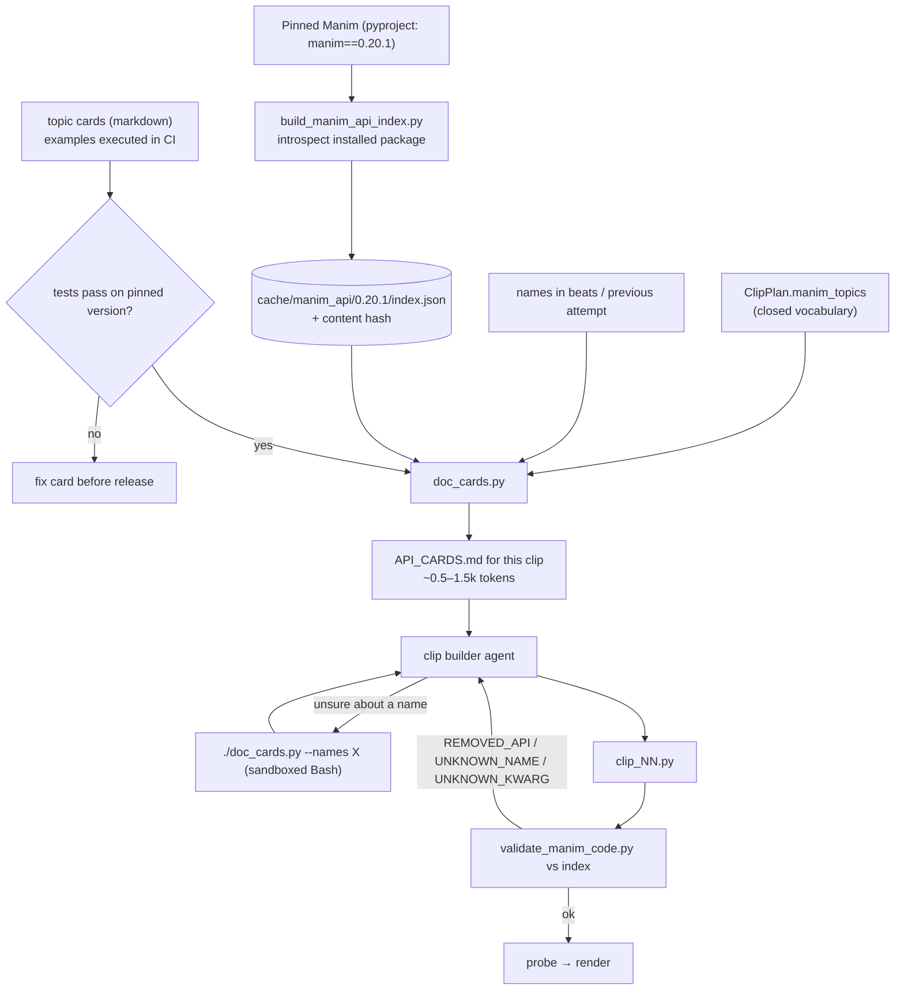
*Purpose:* the code generator only ever sees documentation for the names it uses, generated from the exact runtime,
and every name it writes is checked against the same index before rendering.

### 13.2 Critic and refactoring loop (conditional)
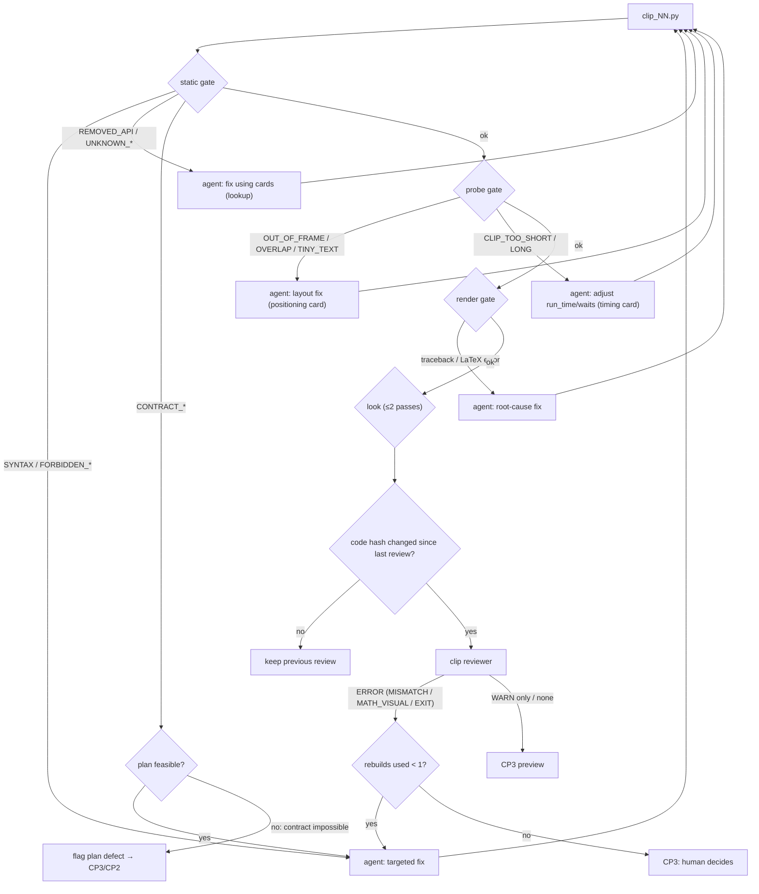
*Purpose:* critics and refactors run only when a specific finding justifies them; each finding code maps to one
targeted action (full table §16.3); nothing re-runs if its inputs are unchanged.

### 13.3 Human-in-the-loop approval workflow
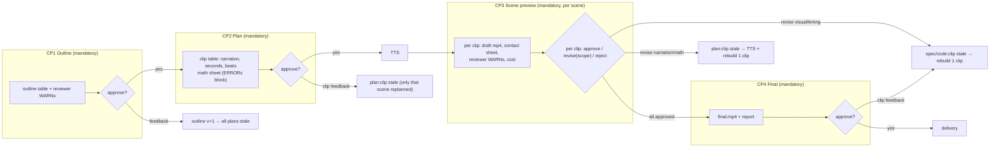
*Purpose:* mandatory gates and their feedback routes. Optional approvals [PROPOSED, config]: auto-approve CP3 for clips
with no reviewer WARNs (`approve_policy: auto_if_clean`) once quality is trusted; math sheet can be auto-approved when
there are 0 findings.

### 13.4 Error handling and retry workflow
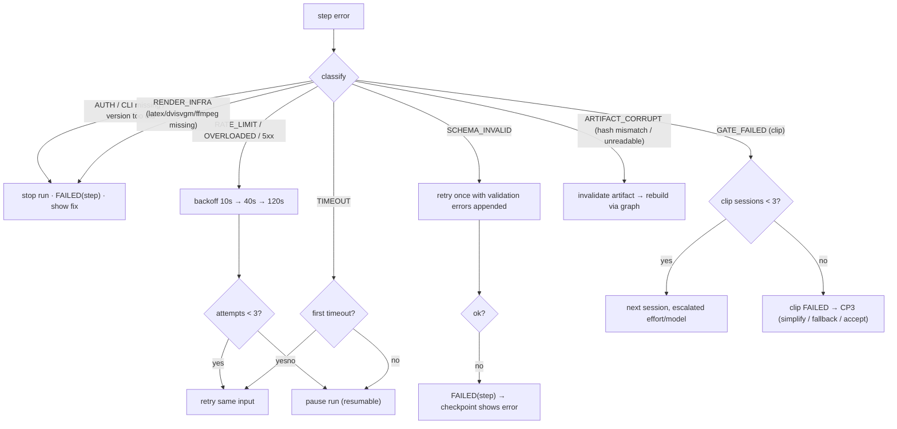
*Purpose:* every error class has one policy; nothing is retried blindly or forever, and every terminal state is
visible in `text-2-shorts status`.

### 13.5 Caching and context reuse
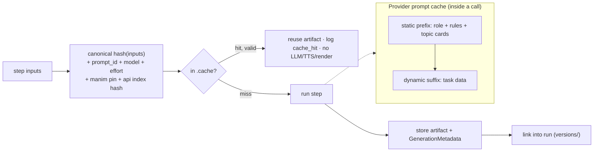
*Purpose:* two independent layers: our **artifact cache** (skips whole calls/renders when inputs are identical) and the
provider's **prompt cache** (makes repeated static prefixes cheap inside calls). Keys and invalidation: §18.

### 13.6 Final scene and video assembly
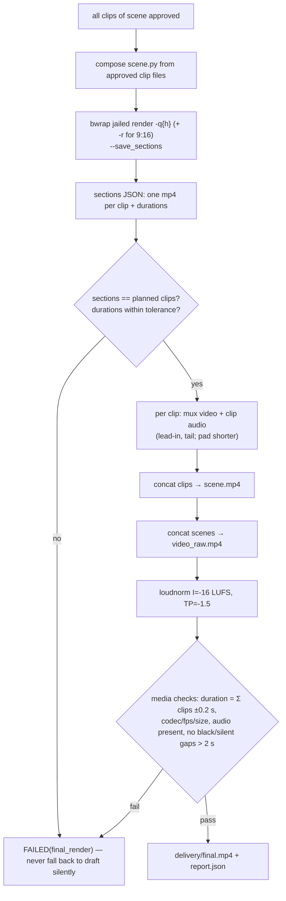
*Purpose:* deterministic assembly with explicit failure instead of today's silent draft fallback (§3.3 #10).

---

## 14. Manim Documentation Strategy

### 14.1 Version
Installed and exercised: **Manim Community v0.20.1** (released 2026-02-27; current stable docs show v0.20.1).
0.20.0 (2026-02-20) is relevant because it **rewrote MathTex splitting** (PR #4515) and added `Mobject.always`
(PR #4594), the `--seed` option, and colour fixes (`YELLOW_C`, `PURE_*`). Sources:
https://docs.manim.community/en/stable/changelog/0.20.0-changelog.html ·
https://docs.manim.community/en/stable/changelog/0.20.1-changelog.html · reference index
https://docs.manim.community/en/stable/reference.html. Versioned docs live under `/en/v0.20.1/`; cards link there.

### 14.2 Behaviour facts verified on the installed package (used in topic cards)
| Fact | Evidence |
|---|---|
| `MathTex("a^2 + b^2 = c^2")` has 1 part (`MathTexPart`, 8 glyphs); multi-string MathTex has one part per string; `{{…}}` splits | executed 2026-11-19 |
| `substrings_to_isolate` does **not** create top-level parts any more; `get_part_by_tex` works | executed |
| `VGroup(Text(…), MathTex(…))` is valid (contradicts a community skill's claim) | executed |
| `Axes.plot`, `plot_line_graph`, `plot_implicit_curve` exist; `get_graph`, `get_line_graph` don't | index |
| `GrowFromCenter`, `ShowPassingFlash`, `ShowPassingFlashWithThinningStrokeWidth` exist | index + render |
| `Scene.next_section(name, section_type, skip_animations)`; `--save_sections` writes per-section MP4 + JSON | executed (harness tests) |
| Quality flags override `manim.cfg` pixel size; `-r W,H` required for portrait | executed |
| Default frame 14.22 × 8.0 units; 1920×1080@60 at default quality | `config` |
| MathTex needs `latex` **and** `dvisvgm` | failed render without dvisvgm |

### 14.3 Retrieval design (minimises LLM calls)
1. **Index** (deterministic, once per pin): all names exported by `from manim import *` with kind, module, MRO,
   `__init__` signature, own and inherited methods, first doc line (`build_manim_api_index.py`, 256 classes /
   147 functions / 159 constants / 23 modules on 0.20.1).
2. **API cards** (deterministic, per clip): exact names → signature, bases, doc line, common + own methods, docs URL
   (`doc_cards.py`; measured ≈ 540 tokens for 4 classes). Unknown names are flagged in the card itself.
3. **Topic cards** (curated, tested): 11 cards, 225–370 tokens each (measured); selected by the planner from a closed list.
4. **On-demand lookup**: the agent may call `doc_cards.py --names` inside the sandbox (no network needed).
5. **Validation**: the same index backs `validate_manim_code.py` (removed APIs, unknown names/methods/kwargs).
6. **Caching**: index keyed by Manim version + content hash; cards keyed by (names, topics, index hash).
No embeddings: names are exact symbols and topics a closed set, so lexical lookup is exact and free. Semantic search
is listed as a future option only if free-form "how do I…" questions appear (§28).

### 14.4 Upgrade procedure (never assume compatibility)
Rebuild index for the candidate version → `pytest tests/test_api_index.py tests/test_topic_cards.py` → diff the two
indexes (removed/renamed names) → read changelogs in between → update `removed-apis.md` + validator REMOVED table →
invalidate `api:all` (code/specs rebuild; plans and audio survive, `test_manim_upgrade_invalidates_all_specs_and_code`)
→ golden-set regression (§22.4) → bump pin.

---

## 15. Human-in-the-Loop Design

### 15.1 Checkpoints
| CP | What the human sees | Mandatory | Can change | Cost of a change |
|---|---|---|---|---|
| CP1 Outline | scene table (title, type, seconds, talking points, visual plan), reviewer WARNs | yes | anything structural | 1 refactor call; all scene plans become stale (none exist yet on first pass) |
| CP2 Plan | per clip: narration, seconds (est.), beats, math; math sheet | yes | narration, math, beats, clip split/merge (scene-level replan) | 1 clip-planner call for that scene (+ verifier for its changed clips) |
| CP3 Scene preview | per clip: draft MP4 (with audio), contact sheet, reviewer WARNs, attempts/cost; scene draft | yes, per scene | per clip: visual, timing, narration, math | typically 1 clip-builder session (+ reviewer) |
| CP4 Final | final MP4, report (duration, cost, checks) | yes | per clip or per scene | as CP3 + final re-render of that scene |
Optional (config): auto-approve CP3 clips with zero WARN findings; auto-approve math sheet with zero findings.

### 15.2 States, storage, versions
- `ApprovalState`: draft → pending_review → approved | revision_requested | rejected; any approved artifact becomes
  **stale** when an upstream input hash changes (computed, never hand-set).
- Feedback: append-only `runs/<id>/feedback.jsonl` of `HumanFeedback` (target kind/id/version, action, scope, text);
  `resolved_by_version` set when a new version addressing it is produced. Unresolved feedback is shown in `text-2-shorts status`.
- Versions: every artifact write goes to `versions/<kind>/<id>.v<N>.<ext>`; the working path is a copy of the current
  version; `state.json` records version, content hash and input hashes. Rollback = `text-2-shorts rollback <id> --to vN`
  (re-points current version; dependents become stale).
- Conflicting feedback (e.g. two notes on the same clip that contradict): the newer one wins only if it targets the
  current version; otherwise both are shown at the checkpoint and the builder is not run until one is withdrawn.

### 15.3 Regeneration scope (feedback → graph start node)
| Feedback scope | Start node(s) | Typical rebuild set (verified by `tests/test_invalidation.py`) |
|---|---|---|
| visual | `spec:<clip>` | that clip's code → checks → draft → review → final; its scene + video assembly |
| timing | `spec:<clip>` | same as visual |
| narration | `plan:<clip>` | + TTS of that clip; next clip only if the exit contract changed |
| math | `plan:<clip>` | + math verifier for that clip |
| structure (clip split/merge) | `video_plan:all` for that scene's plans | that scene's clips |
| style tokens | `style:all` | all specs/code (plans and audio survive) |
| Manim pin | `api:all` | all specs/code (plans and audio survive) |

---

## 16. Code Generation and Validation

### 16.1 Code structure (per scene directory)
```
scenes/s02/
  manim.cfg                 # from config/manim.{landscape|portrait}.cfg
  scene.py                  # GENERATED by scene_harness compose — never edited by an LLM
  clips/__init__.py
  clips/clip_01.py          # approved code: `from manim import *` + one `def clip_01(self):`
  clips_work/clip_02/       # agent cwd for the active build: TASK.md, API_CARDS.md, clip_02.py, check, checks/, frames/
  audio/s02c01.mp3 …
  media/ media_final/ review/
```
Shared utilities: none in v1 (each clip self-contained, so a helper change cannot silently alter approved clips).
A `t2s_helpers.py` with versioned, tested helpers (e.g. callout box) is a future option; adding it must bump
`style:all`. Imports allowed in clips: `manim`, `math`, `numpy`, `random`, `itertools`, `functools`, `typing`.

### 16.2 Controlled validation loop
Generate → **static** (`validate_manim_code.py --clip-file --entry --exit`) → compose → **probe** (`layout_probe.py
--budget`, dry-run ≈ seconds) → **render** single clip (`scene_harness.py render --target`, draft `-ql`) → **look**
(frames at beat boundaries) → agent finishes → orchestrator **re-checks** (`./check all`) → **review** (conditional)
→ human. Rendering never starts while static or probe gates fail. Execution isolation: agent Bash inside the Claude
Code sandbox (no network, writes only in cwd + Manim/font caches; `failIfUnavailable: true`); final renders in bwrap
(read-only host, no network). Timeouts: probe 120 s, draft render 600 s, final scene render 3600 s, agent session
2400 s [PROVISIONAL]. Error capture: every check writes `checks/<gate>.json` (findings with stable codes, stderr tail).

### 16.3 Repair routing (finding code → action) — deterministic, no LLM to decide
| Code | Source | Action | Escalation |
|---|---|---|---|
| SYNTAX, FORBIDDEN_IMPORT, FORBIDDEN_CALL, CLIP_FILE | static | agent targeted fix | 3rd repeat → next session at higher effort |
| REMOVED_API, UNKNOWN_NAME, UNKNOWN_KWARG | static | agent fix using `doc_cards` lookup; card shows the replacement | same |
| UNKNOWN_METHOD (WARN) | static | agent verifies via lookup; may keep if it resolves on the actual object | — |
| CONTRACT_READ, CONTRACT_EXIT | static | agent fix; if the contract is impossible (needs an object the previous clip doesn't leave) → **plan defect** | CP3 shows plan defect; feedback → `plan:<clip>` |
| OUT_OF_FRAME, OVERLAP, TINY_TEXT | probe | agent layout fix (positioning card) | 2 failed fixes → simplify layout (fewer simultaneous objects) |
| CLIP_TOO_SHORT / CLIP_TOO_LONG | probe | adjust run_time/waits along beats (timing card) | if impossible within ±30%: plan defect (narration too long/short for beats) |
| CLIP_NOT_RUN | probe | composition error → orchestrator bug, not agent | stop, report |
| Render traceback (Python) | render | root-cause fix; replacement names re-validated | — |
| LaTeX error | render | fix LaTeX string; if string came from plan → math verifier note | CP2/CP3 |
| MISMATCH, MATH_VISUAL, EXIT (reviewer ERROR) | review | one rebuild with defects as LAST FINDINGS | then CP3 |
| CLARITY, STYLE (reviewer WARN) | review | none; shown at CP3 | human |

### 16.4 Retry strategy
Within a session: the agent loops gates (no fixed render cap; bounded by the 2400 s timeout).
Across sessions per clip: session 1 sonnet/high; session 2 sonnet/xhigh starting from the previous file + findings;
session 3 opus/high; then FAILED → CP3 with options: simplify (feedback), static fallback (title card + narration),
accept partial. Never a fourth automatic session.

### 16.5 Refactoring rules
Targeted: the next session starts from the current file and the open findings only. "Do not rewrite working beats"
is enforced by review of the diff size: if a repair session changes > 60% of lines while fixing a single finding
[PROVISIONAL], the orchestrator records `REWRITE_SUSPECT` (WARN at CP3).

### 16.6 Final media checks (deterministic)
Sections present for every planned clip; each muxed clip ≥ its narration; Σ clips = final ± 0.2 s; video codec H.264,
yuv420p, expected size and fps; audio AAC 48 kHz stereo; integrated loudness −16 ± 1 LUFS (ffmpeg `ebur128`);
no black frames > 2 s (`blackdetect`) and no silence > 2 s inside narration spans (`silencedetect`) [PROPOSED].

---

## 17. Audio and Narration Architecture
- **Script:** narration written per clip by the clip planner (exact TTS text; symbols spelled as spoken).
- **Voice:** Kokoro (local ONNX, free, no word timestamps) or AWS Polly neural/generative/standard [EXISTS engines].
  Polly can return word-level **speech marks** (separate request with `OutputFormat=json`, `SpeechMarkTypes=["word"]`)
  → `AudioArtifact.word_marks` → TASK.md lists phrase start times [PROPOSED]. Kokoro: phrase times estimated
  proportionally by characters [PROPOSED]; good enough because beats only need phrase-level sync.
- **Duration estimation → measurement:** words/WPM at planning (validated); real seconds after TTS drive the code
  budget (`--budget clip_NN=<seconds>`).
- **Pauses:** lead-in 0.25 s, tail 0.35 s per clip [PROVISIONAL]; longer pauses are written into narration as sentence
  breaks, not silence padding, so the visual hold is planned.
- **Sync rules:** clip animation ≥ narration − 0.5 s and ≤ narration + 1.5 s; formulas stay ≥ 2 s after their sentence;
  one visual event per phrase. Assembly pads per clip, so drift never accumulates.
- **Mixing:** v1 narration only; loudness normalised once on the final video (−16 LUFS, TP −1.5 dB).
  Background music / SFX [PROPOSED, future]: music bed ducked under narration (`sidechaincompress`), SFX cues as
  beat annotations; scene transitions via crossfade of 0.3 s only if both clips' exit/entry frames are compatible.
- **Failures:** TTS error → retry once; Kokoro model missing → download with SHA-256 pin [PROPOSED]; Polly credentials
  never enter the sandbox (TTS runs in the orchestrator process).
- **Cache:** key = hash(text, voice, engine, engine version); narration edits re-synthesize one clip.

---

## 18. Token Optimization, Caching and Cost Management

### 18.1 Artifact cache (content-addressed, `.cache/`, survives across runs)
| # | Artifact | Key (hash of) | Invalidated when | Store |
|---|---|---|---|---|
| 1 | Research results (opt.) | brief + prompt_id | brief changes | `.cache/llm/` |
| 2 | Outline | refined brief + approach + options + prompt_id + model/effort | any of those | `.cache/llm/` |
| 3 | Scene/clip plans | scene outline + style + prev exit + scoped feedback + prompt_id | outline scene or feedback changes | `.cache/llm/` |
| 4 | Clip narration | part of plan | plan changes | — |
| 5 | Doc cards | names + topics + index hash | Manim pin / topic card edit | `.cache/cards/` |
| 6 | Generated code | TASK.md hash (plan, audio seconds, contracts, feedback) + cards hash + prompt_id + model | any input | `.cache/llm/` + versions |
| 7 | Validation results | code hash + index hash + validator version | code/index/tool change | `.cache/checks/` |
| 8 | Critic evaluations | code hash + plan hash + frames hash + prompt_id | code change | `.cache/llm/` |
| 9 | Rendered clips | scene code hash (all clips ≤ target) + quality + aspect + Manim version | any earlier clip code changes | `.cache/render/` |
| 10 | Audio | text + voice + engine + engine version | narration edit | `.cache/tts/` |
Persistence: files + `index.sqlite` [PROPOSED] or a JSON index (v1). Integrity: content hash verified on read;
mismatch → `ARTIFACT_CORRUPT` → invalidate (§13.4). Cache is an optimisation: deleting `.cache/` loses money, not data
(the run's `versions/` keeps everything it used).

### 18.2 Context optimisation (what each call receives)
Outline review: outline only. Clip planner: one scene + one-line summaries of others + previous exit — never the whole
outline/narration. Math verifier: narration + math strings only. Clip builder: TASK.md (one clip) + cards for its names
— never other clips' code or the Manim catalog. Reviewer: ≤ 8 downscaled frames + plan. Static instructions identical
across calls (prompt cache); no summarisation calls anywhere (state is structured, so there is nothing to summarise).

### 18.3 Selective regeneration
Implemented by the ledger + `invalidation.rebuild_plan(changed, unchanged_outputs)`; the "unchanged outputs" set
(e.g. a plan edit that leaves the exit contract byte-identical) stops propagation, so neighbours are not rebuilt.
`text-2-shorts explain` prints the set before anything runs.

### 18.4 Model selection
Haiku/low: refine. Sonnet/medium: outline review, clip review. Sonnet/high: outline, clip planning, math verification,
clip building (session 1). Escalation: xhigh, then Opus/high for session 3 or advanced math. Deterministic everywhere
else. All in `config/stages.yaml`; the exact model id returned by the CLI envelope is logged per call.

### 18.5 Cost model and tracking
Calls for a video with N scenes and M clips (no retries):
- **Today:** 1 refine + 1 outline + ≤2 critic + ≤2 refactor + 1 narration + N×(1 director + ≤2 critic + ≤2 refactor
  + 1–2 agent sessions) → for N = 5: 7–11 + 25–35 = **32–46 calls**, Director/refactor calls each carrying
  ≈ 23k input tokens and large DSL outputs.
- **Proposed:** 1 refine + 1 outline + 1 review (+≤1 refactor) + N planner + 1 verifier + M builder sessions + ≤ M
  reviews → for N = 5, M = 15: **24–40 calls**, but no call carries the 15k-token catalogs and each builder session's
  static prefix is shared across all clips.
Indicative per-token prices (vendored `claude-api` skill snapshot, 2026-11; verify live before quoting):
Sonnet 5.5 $2 / $10 per MTok in/out, cache read $0.20, cache write ×1.25 (5 min); Haiku 5.5 $0.10 / $0.50;
Opus 5.5 $4 / $20. Example (illustrative, not a forecast): a clip-builder session with 150k cached-read, 20k
cache-write, 30k uncached input and 8k output tokens ≈ $0.03 + $0.05 + $0.06 + $0.08 ≈ **$0.22**. Real numbers come
from `cost_report.py` on Phase 0 runs; **all cost targets are [PROVISIONAL] until then.**
Tracked per call: stage, clip, prompt_id, model, effort, attempt, ok, cost, input/output/cache tokens, artifact
cache hit, duration. Reported per run: total, per stage, per clip, first-attempt gate success, cache-read ratio.

---

## 19. Data Models and Schemas
Source of truth: `schemas/models.py` [BUILT-HERE, tested]; JSON Schemas generated into `schemas/json/` (21 files).

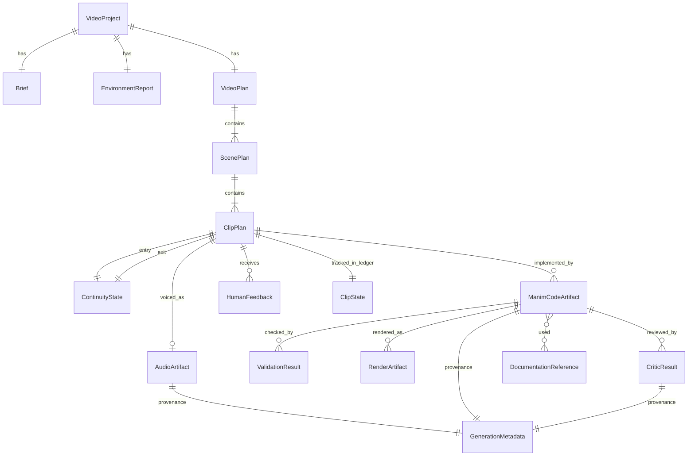
Identifiers: run `YYYYmmdd-HHMMSS-slug`; scene `sNN`; clip `sNNcMM`; versions are integers per artifact; content
hashes are SHA-256 over canonical JSON or file bytes. Every generated artifact carries `GenerationMetadata`
(producer, kind llm/deterministic/human, prompt_id, model, effort, input_hashes, tokens, cost, attempt) whose
`cache_key()` is the artifact-cache key. Complete project reconstruction = ledger + `versions/`; independent clip
regeneration = ClipState + its input hashes.

Representative `ClipState` row in `state.json`:
```json
{"clip_id":"s02c03","plan_version":2,"plan_hash":"9f1c…","approval":"pending_review",
 "audio":{"kind":"audio","path":"scenes/s02/audio/s02c03.mp3","version":1,"content_hash":"a41e…"},
 "code":{"kind":"code","path":"scenes/s02/clips/clip_03.py","version":3,"content_hash":"07bd…"},
 "render":{"kind":"clip_draft","path":"scenes/s02/media/…/Scene02_0002_clip_03.mp4","version":3,"content_hash":"c9e2…"},
 "validations":{"static":"passed","layout":"passed","timing":"passed","render":"passed"},
 "attempts":2,"last_error":null}
```
`HumanFeedback` example:
```json
{"feedback_id":"fb_0007","target_kind":"clip_render","target_id":"s02c03","target_version":3,
 "action":"revise","scope":"visual","text":"Highlight c, not b, when the hypotenuse is named."}
```

---

## 20. Complete Project Structure (target)
Preserves `app/graph/models` and the outline prompts in place; moves the rest out of the 549-line `pipeline.py`.
```
app/
  cli.py                       NEW   `text-2-shorts` commands (§12); thin argparse layer
  config.py                    NEW   .env + config/stages.yaml loader
  pipeline.py                  KEPT  legacy commands until parity (Phase 6), then removed
  graph/models/*.py            KEPT  outline schemas (unchanged)
  graph/prompts/script_gen_prompt.py, outline_critic_prompt.py   KEPT (patched)
  graph/prompts/visual_*.py, render_debug_prompt.py, manim_reference.py   RETIRED after Phase 8 (kept in git history)
  contracts/models.py          NEW   = schemas/models.py
  orchestrator/ledger.py       NEW   state.json, versions/, atomic writes, resume
  orchestrator/graph.py        NEW   = tools/invalidation.py
  orchestrator/steps.py        NEW   new/outline/plan/build/final step functions
  orchestrator/checkpoints.py  NEW   approvals, feedback → graph nodes
  llm/runner.py                MOVED from pipeline.claude(); + error classes, backoff, cache, usage logging
  llm/prompts/{outline_review,clip_planner,math_verifier,clip_builder,clip_reviewer}.py   NEW (prompts/*.md)
  manim_docs/{api_index,doc_cards}.py, topics/   NEW (from tools/ + skill)
  render/{harness,check,validate,probe,sandbox}.py   NEW (from tools/; sandbox = bwrap invocation from pipeline.py)
  audio/{tts,timing}.py        MOVED kokoro_tts/polly_tts; per-clip, cached, speech marks
  assembly/{assemble,media_checks}.py   NEW (from tools/assemble_clips.py)
  cache/store.py               NEW   content-addressed store
  observability/{log,cost}.py  NEW   structured log rows, cost_report
config/                        stages.yaml, sandbox.json, manim.*.cfg, .env.example
.claude/skills/make-short/     operator skill (reconstructed)
.claude/skills/manim-ce-0-20-1-reference/, text-2-shorts-clip-debugging/, text-2-shorts-prompt-maintenance/
tests/                         unit, contract, fixtures, golden/
runs/<id>/                     state.json, brief.json, environment_report.json, outline*.json, plan/, scenes/,
                               feedback.jsonl, versions/, delivery/, log.jsonl, .prompts/
.cache/                        llm/, tts/, render/, checks/, cards/, manim_api/
```
No frontend/backend split exists or is introduced in v1: the "frontend" is the Claude Code session + generated review
artifacts (contact sheets, draft MP4s, markdown tables). A local review web page is a future enhancement (§28).

---

## 21. Error Handling and Recovery
| Failure | Detection | Policy | Visible as |
|---|---|---|---|
| Claude API/CLI failure (auth, CLI missing, old version) | preflight; envelope `is_error` + message class | fatal for the step, no retry | `FAILED(step)` + fix hint |
| Rate limit / overloaded / 5xx | envelope/stderr classification | backoff 10 s, 40 s, 120 s; then pause (resumable) | `PAUSED` |
| Timeout | subprocess timeout | 1 retry, then pause | log + status |
| Invalid structured output | Pydantic `ValidationError` | 1 retry with errors appended; then FAILED(step) | checkpoint shows error |
| Claude Code agent failure (turn limits, crash) | envelope subtype; missing files | next escalation session (≤ 3) | clip attempts in status |
| Manim compile/runtime error | render gate traceback | targeted agent repair | `checks/render.json` |
| LaTeX failure | render stderr (LaTeX log) | fix string; plan-originated → note to math verifier | finding `LATEX_ERROR` |
| Missing dependency (latex, dvisvgm, ffmpeg, bwrap, socat) | preflight | refuse to start rendering | preflight report |
| Unsupported API | static gate | fix via cards before render | REMOVED_API/UNKNOWN_* |
| Audio generation failure | exception / zero-length file | retry once; then FAILED(tts) for that clip only | status |
| Corrupted intermediate artifact | hash mismatch / unreadable on load | invalidate + rebuild through graph | `ARTIFACT_CORRUPT` |
| Cache inconsistency (entry points to missing file) | load-time check | drop entry, treat as miss | log WARN |
| Human feedback conflict | two open feedback items on same target/version | hold the target; show both at checkpoint | status |
| Interrupted session (Ctrl-C, crash, reboot) | ledger shows step `running` with no live PID | `text-2-shorts resume` re-runs that step (idempotent writes: temp file + atomic rename) | status |
| Final render failure | non-zero exit / missing sections | FAILED(final_render) — **never** fall back to drafts silently (fixes §3.3 #10) | status + report |
| Agent claims READY but checks fail | orchestrator `./check all` | record FAILED (`CLAIM_MISMATCH`) | status |
Principle: an error is either retried under a stated policy, or it stops the affected unit with a visible status.
No code path converts an exception into success; every terminal state is in `state.json` and `log.jsonl`.

---

## 22. Testing and Quality Assurance

### 22.1 Test layers
| Layer | What | Where | Status |
|---|---|---|---|
| Unit — tools | API index, validator (incl. clip contracts), probe (overlap, off-frame, zoom rule, per-clip timing), harness (sections, target render, portrait), assembly (per-clip sync), invalidation, cost report | `tests/test_*.py` | **[BUILT-HERE] 38 passing** |
| Unit — contracts | Pydantic validators (ids, continuity, extra fields), cache-key stability | `tests/test_models.py` | [BUILT-HERE] |
| Manim API compatibility | topic-card examples validate + dry-run render on the pin; prompt catalog audit | `tests/test_topic_cards.py`, `tools/audit_prompt_catalog.py` | [BUILT-HERE] |
| Structured output | every stage's schema accepts a recorded golden output and rejects known-bad ones | `tests/contracts/` | [PROPOSED] |
| Agent prompt tests | recorded LLM outputs replayed (no live calls) through parsers/routers; prompt static-prefix byte-stability test | `tests/prompts/` | [PROPOSED] |
| Clip rendering | fixture clips render via harness; known-bad clips produce expected finding codes | `tests/fixtures/` | partially [BUILT-HERE] |
| Mathematical correctness | math_lint on fixtures (LaTeX compiles; sympy spot checks); verifier evals on seeded errors | `tests/math/` | [PROPOSED] |
| Scene continuity | contract mismatch fixtures (planner + validator); section continuity test | partly [BUILT-HERE] | |
| Audio sync | muxed clip ≥ narration; Σ clips = final ±0.2 s | `test_assemble_clips.py` | [BUILT-HERE] |
| Full-video integration | `text-2-shorts` end-to-end on 2 golden topics with `T2S_MODEL=haiku` (cheap smoke) and with default models (nightly/manual) | `tests/golden/` | [PROPOSED] |
| Cache invalidation | changing each input class changes exactly the expected keys | `tests/test_cache.py` | [PROPOSED] |
| Selective regeneration | graph rebuild sets per feedback scope | `test_invalidation.py` | [BUILT-HERE] |
| HITL workflow | scripted approve/revise sequences against a fake runner; ledger states | `tests/test_checkpoints.py` | [PROPOSED] |
| Token/cost regression | golden runs: tokens and cost per clip vs baseline ±10% | `reports/baseline.json` + `cost_report.py` | [PROPOSED] |

### 22.2 Quality indicators (all targets [PROVISIONAL] until Phase 0/13 baselines)
| Indicator | Definition | Source | Initial target |
|---|---|---|---|
| Clip render success | clips reaching `gated` / clips attempted | ledger | ≥ 95% within 3 sessions |
| First-session gate success | clips passing all gates in session 1 | ledger | baseline then +20 pts |
| Average sessions per clip | builder sessions / clips | log | ≤ 1.4 |
| Tokens & cost per clip | log totals / clips | `cost_report.py` | baseline −30% vs scene-level today (per minute of video) |
| Artifact cache hit ratio (re-runs) | hits / lookups | log | ≥ 80% on unchanged re-run |
| Prompt cache read ratio | cache_read / (read+write) for static-prefix stages | log | ≥ 70% |
| Cost per video minute | total / minutes | report | baseline |
| Wall time per clip | log | report | baseline |
| Human revision rate | clips with ≥1 revise at CP3 / clips | feedback.jsonl | tracked, no target |
| Math defects reaching CP4 | human math feedback at CP3/CP4 | feedback | 0 |
| A/V sync | narration cut-offs | assembly report | 0 |

### 22.3 Key test cases (excerpt; full list derives from the tables above)
TC-01 REMOVED_API caught pre-render (fixture `bad_scene.py`) · TC-02 off-frame title + overlapping labels caught
(`bad_layout.py`) · TC-03 clip shorter than narration fails, within tolerance passes · TC-04 single-clip render runs
earlier clip code without frames, never runs later clips · TC-05 9:16 renders portrait · TC-06 visual feedback on one
clip rebuilds 1 clip + its scene/video only · TC-07 unchanged exit contract stops propagation · TC-08 Manim pin bump
keeps plans and audio · TC-09 entry contract not provided by previous exit is rejected at planning · TC-10 per-clip mux
never cuts narration and accumulates no drift.

### 22.4 Golden topics (regression set) [PROPOSED]
G1 "Pythagorean theorem" (geometry, MathTex transforms), G2 "Derivative as slope" (axes, ValueTracker),
G3 "Binary search" (non-math, arrays, emphasis). Each run at 2 minutes, both aspects, cached plans reused so the
regression isolates code-generation quality.

---

## 23. Observability and Cost Tracking
- **Log row** (`log.jsonl`, superset of today's): `ts, run_id, step, stage, scene_id, clip_id, prompt_id, model, effort,
  attempt, ok, error_class, cost_usd, input_tokens, output_tokens, cache_read, cache_write, artifact_cache_hit,
  duration_ms, input_hashes, output_hash`. Deterministic steps log the same row with `kind: deterministic`.
- **Events** (ledger transitions): `step_started/finished/failed`, `checkpoint_opened/approved/revised`,
  `artifact_versioned`, `artifact_invalidated(reason)`.
- **Reports:** `text-2-shorts report` → per stage/clip cost, tokens, cache ratios, sessions per clip, gate findings histogram
  (most frequent codes → candidates for new validator rules or topic cards), wall time.
- **Prompts:** every call's exact system/user text saved under `.prompts/<stage>/<clip>.<attempt>.md` (today: one file
  per stage, overwritten).
- **Status:** `text-2-shorts status` renders the ledger: phase, per-clip state, open feedback, spend.

---

## 24. Security and Execution Isolation
| Threat | Control | Status |
|---|---|---|
| LLM-written code accesses network/files | Claude Code Bash sandbox (bubblewrap): no network, writes only cwd + Manim/font caches; `allowUnsandboxedCommands:false`; **`failIfUnavailable:true`** | sandbox [EXISTS]; fail-closed [PROPOSED: `config/sandbox.json`] |
| File tools (Read/Write/Edit) escape the clip dir | `--restricted` confines built-in file tools to working directories; cwd = clip work dir | [EXISTS] flag; narrower cwd [PROPOSED] |
| Secrets readable by generated code | sandbox `denyRead`: `~/.aws`, `~/.ssh`, `~/.config/gcloud`, `~/.claude.json`, `~/.netrc`, `.env`; TTS (Polly creds) runs outside the sandbox | [PROPOSED] |
| Static escape attempts in code | validator FORBIDDEN_IMPORT/FORBIDDEN_CALL (os, subprocess, socket, open, exec, eval…) before any execution | [BUILT-HERE] |
| Final render of approved code | bwrap jail: read-only host, no network, `--die-with-parent`, writable scene dir + ~/.cache only | [EXISTS] |
| Unattended permission prompts | `--permission-prompts none` (denials, never hangs) | [EXISTS] |
| Supply chain | pinned Manim; Kokoro model SHA-256 pin; vendored skills recorded with commit ids; community skills reviewed before use | [PROPOSED] |
| Prompt injection via topic text | topic text only reaches planning roles without tools; the agent's TASK.md derives from validated structured plans | [PROPOSED] |
| Repository-provided config | project `.claude/settings.json` is not trusted for sandbox relaxations; runner passes `--settings config/sandbox.json` + `--safe-mode` for non-agent calls | [EXISTS]/[PROPOSED] |
Note: bubblewrap inside Docker requires user namespaces; in containers, the container is the isolation boundary.

---

## 25. Implementation Roadmap
Critical path: P1 → P2 → P5 → P6 → P7/P8 → P12 → P13. Phases 3–4 run alongside 2. Each phase ends green on
`pytest` and with an entry in `CHANGELOG.md`.

| # | Phase | Objective | Reuse | Modify | New | Depends | Deliverables | Acceptance criteria | Risks |
|---|---|---|---|---|---|---|---|---|---|
| 1 | Existing app audit & baseline | Measure before changing | `log.jsonl`, current CLI | — | `cost_report.py` [BUILT-HERE], 3 golden runs | — | `reports/baseline.json` (cost, time, sessions per scene, failures) | Baseline for G1–G3 recorded; audit findings §3.3 confirmed on a live run | Live runs cost money — use 2-min videos |
| 2 | Product & data model finalisation | Contracts + ledger | outline schemas | `pipeline.claude()` → `llm/runner.py` (behaviour-preserving) | `contracts/models.py` [BUILT-HERE], `orchestrator/ledger.py`, `config.py`, `stages.yaml`, `text-2-shorts status/resume` | 1 | ledger with atomic writes, versions/, resume | Interrupt any step and resume without redoing finished steps; legacy commands still work | Ledger/legacy dual state — legacy writes mirrored into ledger |
| 3 | Agent architecture refinement | Freeze roles and boundaries (§9) | — | runner: error classes, backoff | — | 2 | ADR file; runner tests with fake CLI | Each error class follows §21 in tests | — |
| 4 | Prompt engineering | New/fixed prompts as code | outline prompts | patches (`existing_prompt_fixes.md`) | `llm/prompts/*.py` (static/dynamic split) | 2 | prompts + replay tests | Static prefixes byte-stable; schemas agree with prompts; catalog audit clean | Prompt quality only provable on live runs → P13 |
| 5 | Video & scene planning | Outline review + clip planner + math verifier | outline stage | `cmd_outline` → steps; deterministic outline checks | `outline_review`, `clip_planner`, `math_verifier`; CP1/CP2 | 2, 4 | `text-2-shorts new/plan/approve`, plan tables, math sheet | G1–G3 produce valid ScenePlans first try ≥ 2/3 scenes [PROVISIONAL]; contract violations impossible to approve | Planner over/under-splits clips — tune with examples |
| 6 | Clip-level planning & generation | Clip builder agent per clip | render agent invocation, sandbox | cwd per clip; TASK.md/API_CARDS.md generation | `render/check.py` (`./check`), builder prompt, CP3 previews | 5, 7 | `text-2-shorts build --scene` | One golden scene builds clip-by-clip; agent cannot write outside its clip; READY re-checked | Agent sandbox edge cases (ffmpeg approvals already seen) |
| 7 | Manim documentation integration | Index + cards + topics in the loop | — | — | `manim_docs/*` [BUILT-HERE tools], topic cards [BUILT-HERE] | 2 | cards per clip in TASK | Cards ≤ 1.5k tokens/clip; 0 REMOVED_API at render time on golden set | Missing topics → add cards from findings histogram |
| 8 | Code generation & execution | Gates + harness + final render | bwrap jail | final render via sections; no silent fallback | `render/*` [BUILT-HERE tools], media checks | 6, 7 | single-clip draft, final per-scene with sections | TC-01…TC-05 pass in CI; final failure surfaces as FAILED | Section render time for long scenes |
| 9 | Critic & refactoring loops | Conditional reviewer + routing | — | — | `clip_reviewer`, repair router (§16.3), contact sheets | 8 | review records, routed repairs | Reviewer runs only on changed code; single vs split critic A/B done | Vision judgement variance |
| 10 | Human-in-the-loop workflows | Approvals, feedback, rollback | `--feedback` idea | — | `checkpoints.py`, `feedback.jsonl`, `text-2-shorts feedback/approve/rollback/explain`, make-short skill | 2, 5, 6 | all four CPs | Scripted HITL tests pass; feedback scopes map per §15.3 | UX in chat — keep tables short |
| 11 | Token optimisation & caching | Artifact cache + prompt-cache layout | cache token logging | runner cache lookup | `cache/store.py`, boundary marker, `--exclude-dynamic-system-prompt-sections` | 2, 4 | cache + metrics | Unchanged re-run: ≥ 80% artifact hits, 0 LLM calls for unchanged clips; prompt cache read ratio ≥ 70% [PROVISIONAL] | Hidden inputs missing from keys → stale reuse (test every input class) |
| 12 | Audio & video assembly | Per-clip TTS + assembly + loudness | Kokoro/Polly | per-clip synthesis, speech marks | `audio/*`, `assembly/*` [BUILT-HERE core] | 5, 8 | `text-2-shorts final` | TC-10 passes; −16 LUFS ±1; no narration cut | Kokoro phrase timing estimates |
| 13 | Testing & QA | Full suite + golden regression | — | — | contract/prompt replay/golden tests, CI | all | CI green; regression report vs baseline | Cost per clip and first-session success measured vs P1 baseline; targets set from data | Live-run cost of goldens |
| 14 | Production readiness | Hardening & ops | — | sandbox config | sandbox fail-closed, Kokoro SHA pin, Docker image, runbook | 13 | release v0.2 | Security table §24 all [EXISTS]; fresh-machine install < 30 min with docs | Docker + bwrap nesting |

**Critical vs optional.** Critical for v1: 1, 2, 5, 6, 7, 8, 10, 12. Important but can trail:
3, 9 (reviewer can start as CP3-only human review), 11 (artifact cache first, prompt-cache tuning later), 13 goldens.
Optional/future: research agent, music/SFX, review web UI, parallel clips.

**Suggested first vertical slice (end of P8):** G1 "Pythagorean theorem", 1 scene × 3 clips, from `text-2-shorts new` to a
muxed scene MP4, with CP1–CP3 in chat — proves contracts, audio-first timing, gates, sections and assembly together.

---

## 26. Risks, Trade-offs and Open Questions

### 26.1 Risks
| ID | Risk | Likelihood / impact | Mitigation |
|---|---|---|---|
| R1 | Removing the Director DSL lowers visual richness | M / M | Beats + topic cards + reviewer; A/B on golden set in P9; DSL ideas folded into cards; keep DSL code in git |
| R2 | Clip planner produces impossible contracts | M / M | Pydantic validation at plan time; CONTRACT_* routed as plan defects |
| R3 | Builder agent loops expensively | M / H | gates before render; ≤ 3 sessions; findings histogram drives tool/card fixes |
| R4 | Probe false positives (e.g. intentional overlap, partial cropping) | M / L | WARN-level overrides via plan field `allow_overlap: [names]` [PROPOSED]; zoom rule already built |
| R5 | Claude Code CLI flag/behaviour changes | M / H | preflight version checks; pin CLI version; runner integration test with fake CLI |
| R6 | Subscription usage limits vs API billing | M / M | stays sequential; usage visible; decision Q2 |
| R7 | Kokoro gives no word timings → coarse sync | H / L | phrase-level beats are enough; Polly speech marks when precise sync matters |
| R8 | Section renders of long scenes slow down final renders | L / M | per-clip cached renders; scenes are 30–90 s |
| R9 | Runtime Python 3.14 (`.pyc` evidence) vs tests on 3.12; `audioop` removed in 3.13 (pydub warns) | M / M | run the suite on 3.14 in P1; pin Python in pyproject |
| R10 | Topic cards incomplete for some topics | H / L | closed vocabulary grows from findings; each new card must have a rendering example |
| R11 | Cache key misses a hidden input → stale reuse | L / H | key = all declared inputs; P11 tests per input class; `text-2-shorts rebuild --no-cache` escape hatch |

### 26.2 Trade-offs taken
Determinism over LLM breadth (more tools, fewer prompts); sequential over parallel (simplicity, rate limits,
requirement); file-level clip isolation over shared helpers; no vector search (exact symbols suffice); no LangGraph.

### 26.3 Open questions (decide before the phase noted)
| # | Question | Default assumed here | Decide by |
|---|---|---|---|
| Q1 | Is Claude Code only the operator/agent runtime, or should production runs move to the API/Agent SDK? | Keep CLI runner; SDK backend later | P3 |
| Q2 | Auth/billing: API key vs subscription token for unattended runs | API key for reporting accuracy | P1 |
| Q3 | Default aspect: product name says "Shorts" (9:16) but target length is 4–8 min (typical 16:9) | 16:9 default, 9:16 supported | P5 |
| Q4 | TTS default for production: Kokoro vs Polly (speech marks) | Kokoro for drafts, Polly for final if precise sync wanted | P12 |
| Q5 | Is web research needed for the target topics? | Off | P5 |
| Q6 | Which CP3 approvals may auto-approve? | none in v1 | P10 |
| Q8 | Captions (SRT) in v1? | not in v1; text is available per clip so cheap to add | P12 |
| Q9 | Python version to support (3.12 vs 3.14) | both, CI on both | P1 |
| Q10 | Where do review artifacts go for non-technical reviewers? | local files + chat | P10 |

---

## 27. Acceptance Criteria (system level, v1)
1. `text-2-shorts new` → `text-2-shorts final` produces a playable MP4 for G1–G3 with all four checkpoints exercised and recorded.
2. No render starts on code with static ERROR findings; no clip is READY without orchestrator-verified checks.
3. Single-clip visual feedback rebuilds exactly that clip (LLM calls only for it) plus scene/video assembly.
4. Narration is never cut off; per-clip A/V difference within §17 bounds; final loudness −16 ± 1 LUFS.
5. Every artifact in `runs/<id>/versions/` has provenance (inputs, prompt id, model, cost) and the run can be
   reconstructed from ledger + versions after deleting working files.
6. Interrupting any step and running `text-2-shorts resume` completes the run without repeating finished steps.
7. CI: unit + contract + topic-card tests green on the pinned Manim; catalog audit reports no banned-but-existing or
   unexplained missing names.
8. Measured cost per video minute and first-session gate success are reported against the Phase-1 baseline.
9. Sandbox fails closed (missing bubblewrap → refusal), secrets paths unreadable from clip code (tested).
10. 9:16 output is 1080×1920 end to end.

---

## 28. Future Enhancements
Local review web page (FastAPI + static player, feedback form writing `feedback.jsonl`; `skills/external/webapp-testing`
for its tests) · parallel clip building for independent clips (graph already exposes dependencies; needs rate-limit
aware scheduler) · Agent SDK / Messages API backend for the runner · background music with ducking, SFX cues,
transitions · captions (SRT/burn-in) and chapter markers · 3D scenes (ThreeDScene cards + probe support) · research
agent with source register and on-screen citations · multilingual narration (TTS voices + re-timed clips, same code)
· shared, versioned helper library for recurring visuals · semantic search over Manim guides for free-form questions ·
MCP server exposing the ledger to other tools (`skills/external/_reference-only` → mcp-builder) · learned routing:
findings histogram → automatic proposals for new validator rules and topic cards.

---

## 29. Consistency, Explanation Style, Sync, Transitions and Speech [BUILT · v0.3–0.4]
Requirements from the CCW-V01 review: (1) prompt caching and context reuse, (2) universal rules across the video,
(3) ELI5/Feynman explanations, (4) narration synchronised with the picture, with pauses, (5) meaningful scene
transitions, (6) SSML speech with correct symbols, abbreviations, units and case. Diagram: `diagrams/15-standards-sync-speech.mmd`.

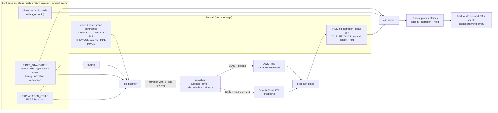

### 29.1 Context sent once (harness-style reuse)
Every stage's system prompt is static and byte-identical across calls, so Claude Code's prompt cache writes it once and
re-reads it cheaply; everything that varies goes in the user message.
| Stage | Static system prompt (cached) | Per call (user message) |
|---|---|---|
| outline | approach prompt + `EXPLANATION_STYLE` | brief |
| clip planner | rules + `VIDEO_STANDARDS` + `EXPLANATION_STYLE` | target scene, other-scene one-liners, symbol colours so far, previous scene's final image, feedback |
| math verifier | rules + narration convention | all clips' narration + math |
| clip agent | contract + loop + `VIDEO_STANDARDS` + always-on topic cards (clip-structure, timing-and-sync, positioning-layout) | `TASK.md` + clip-specific cards in `API_CARDS.md` |
Identical non-agent calls are answered from `.cache/llm/` without a call. Measured on the scene agents: a second
agent with an identical system prompt read ~42k tokens from cache and wrote ~3.5k (first: ~42k written).
Not used: `--exclude-dynamic-system-prompt-sections` (made no measurable difference).

### 29.2 Universal standards (v0.5+: `run-environment/skills/text-2-shorts-produce/references/standards.md`)
Frame 2560×1440, 0.5-unit safe margin, one background (set by the harness). Palette roles: text WHITE · focus YELLOW ·
given BLUE · derived GREEN · warning RED · secondary GREY_B. Type scale 48/34/28/24 (never smaller); MathTex 44/34.
Zones: top_center (title or running formula) · center (diagram) · left/right halves (comparison) · bottom_center
(one-line caption); ≤ 2 text blocks + 1 diagram on screen. Animation timings (Write/Create 0.8–1.5 s, fades
0.4–0.6 s, Transform 0.8–1.2 s, ≥ 0.8 s hold after a key result). Each math symbol keeps one colour for the whole
video: `ScenePlan.color_roles` is carried from scene to scene and the planner may only add new symbols.
Enforced by code: background, font, resolution/fps, timing (probe), tiny text (probe WARN). By instruction only:
colours, type sizes, zones.

### 29.3 Explanation style (`EXPLANATION_STYLE`)
Familiar thing first, then the name; one idea per sentence; every term defined where it first appears; concrete
(picture, worked number) before abstract; show why, not only that; a one-line recap after each key step; talk to one
curious person. Used by the outline and the clip planner. Not checked automatically (a critic dimension is a
candidate once real runs show drift).

### 29.4 Audio–visual synchronisation
- Clip rhythm: the picture starts `LEAD_IN` = 0.3 s before the voice (assembly delays each clip's audio) and holds
  ≥ `HOLD` = 0.8 s after it; the probe fails a clip shorter than lead-in + narration + hold (`CLIP_SECONDS`).
- `[pause]` markers in narration become SSML breaks (600 ms); nothing animates during a pause.
- Beat timing: Polly word speech marks / Google `<mark>` timepoints → `speech.phrase_times()` finds when each beat's
  quoted phrase is spoken → `TASK.md` lists beats as `@ 2.4s …`; the agent lines animations up with `self.wait()`.
Gap: no check verifies that a beat's animation actually starts at its time; frames are sampled every 2 s, not at beats.

### 29.5 Scene transitions
Each scene renders as its own Manim Scene, so objects cannot cross scene boundaries. Rule (enforced in `plan_scene`,
a violating plan is sent back once): the first clip's entry and the last clip's exit are empty. Continuity is visual:
the last clip's final beat leads into the outline's `transition_to_next` and fades the scene out; when the outline
continues an idea, the next scene's first beat re-draws `PREVIOUS SCENE FINAL IMAGE` (same objects, colours, zones).
Gap: scenes still cut (on an empty frame); an assembly crossfade is a candidate.

### 29.6 Speech (`app/narration.py`, AWS Polly or Google Cloud TTS)
Narration convention: math symbols in backticks (`` `a` ``, `` `M` ``, `` `v_1` ``, `` `θ` ``), `[pause]` for pauses.
`speakable()` turns symbols into names (letters → "ay", "bee"…; Greek → "theta"; `r_1` → "ar 1"), a letter used in
both cases anywhere in the video → "capital em" / "small em", math symbols → words (≈, ≠, ≤, ×, √, ², %…), units after
numbers → words (km/h, m/s², °C, AU, Hz…), common abbreviations → words (e.g., i.e., etc.). Providers (chosen per
video, `text-2-shorts new --tts polly|google`): Polly receives SSML (`<break>`) and returns word speech marks; Google receives
SSML with a `<mark>` per word and returns timepoints (v1beta1). Both fall back to plain text for voices that reject
SSML (then no word timings). Kokoro was removed. Gaps: fixed lists rather than a pronunciation lexicon / `<phoneme>`;
"context-aware" relies on the planner marking symbols; not yet validated by listening on real runs.

---

## 30. Claude Code-Native Execution Architecture [BUILT · v0.5]
Requirement: Claude Code is the execution environment — no per-stage API/`claude -p` calls, no prompts in application
code, native features (CLAUDE.md, skills, subagents, hooks, slash commands), OS-enforced isolation per run, an
environment defined once and provisioned per run, progressive context, persistent state and resume.
This supersedes the runner/orchestrator design of §5, §9–§12 and the per-stage prompt layout of §29.1: the stages now
run inside one Claude Code session per run.

### 30.1 Inverted control
| Before (v0.2–0.4) | Now (v0.5) |
|---|---|
| Python orchestrator spawns `claude -p` per stage and per clip | one interactive Claude Code session per run does all reasoning |
| ~110 KB of prompts as Python strings | `run-environment/skills/text-2-shorts-produce/references/*.md` + `run-environment/agents/*.md`, loaded per step |
| LLM result cache, limit waits, per-call log rows in Python | Claude Code's own prompt cache, retries and transcripts; hooks log tool calls |
| `text-2-shorts outline / clips / build` | the session writes outline.json, plan.json; subagents write clip code and math.json |
| — | `text-2-shorts validate / task / accept / hook / report / open` (deterministic) |
Kept unchanged: tools/, `./check`, speech + Polly/Google, harness, assembly, media checks, schemas, state.json,
feedback.jsonl, approvals.

### 30.2 Environment as code (`run-environment/`)
The CDK analogy, implemented with Claude Code's own declarative formats rather than a separate IaC tool: a plugin
(`.claude-plugin/plugin.json`) carrying the skills, the two subagents and the hooks; `settings.json` (session sandbox
and permissions); `workspace/CLAUDE.md` (per-run instructions). `text-2-shorts new` provisions a run from it (brief,
CLAUDE.md, environment report after preflight); `text-2-shorts open` launches `claude --plugin-dir run-environment --settings
run-environment/settings.json --add-dir run-environment --add-dir schemas` in the run folder. Changing the environment
is a reviewed commit under `run-environment/`; every run gets the same environment.

### 30.3 Isolation layers
1. **Run jail** (`text-2-shorts open`, bubblewrap): `/` and the repo read-only; the run folder, `~/.claude` and `~/.cache`
   writable; private tmpfs `$HOME` with PATH tool folders and voice credentials re-mounted read-only. A run cannot
   change another run or shared code. Tested in `tests/test_run_environment.py`.
2. **Session sandbox** (`run-environment/settings.json`): Claude Code's bubblewrap sandbox for every Bash command — no network
   (except `text-2-shorts voice`, excluded so it can reach Polly/Google), secrets unreadable, fails closed; permission deny
   rules on the same secrets for the Read tool.
3. **Clip jail**: `text-2-shorts accept` re-runs every gate on LLM-written clip code and `text-2-shorts final` renders it in a
   network-less bwrap jail with only the clip/scene folder writable.
Limit: the clip-builder subagent shares the session's write access (the whole run folder); a clip is only
installed by `text-2-shorts accept`, so a wrong write cannot reach `clips/` without passing every gate.

### 30.4 Context and recovery
`CLAUDE.md` (≈ 1 KB) and the skill body load every session; references are read at the step that needs them; the
clip-builder subagent gets a fresh context per clip with `TASK.md`, the standards, three always-on cards and the
clip's own cards; the math-reviewer reads only plans. The SessionStart hook injects `text-2-shorts status` (approvals, clip
states, next steps), so a resumed session continues without re-reading files. State that matters is in files
(state.json, feedback.jsonl, plan files, clip keys); `text-2-shorts status` derives the next step from them.

### 30.5 Validation and observability
PostToolUse hook: logs every tool call to `log.jsonl` and validates outline.json / plan.json / math.json right after
they are written (exit 2 returns the errors to Claude). `text-2-shorts report`: token totals from the run's transcripts
(recorded by the SessionStart hook), each model response counted once, subagents included.

